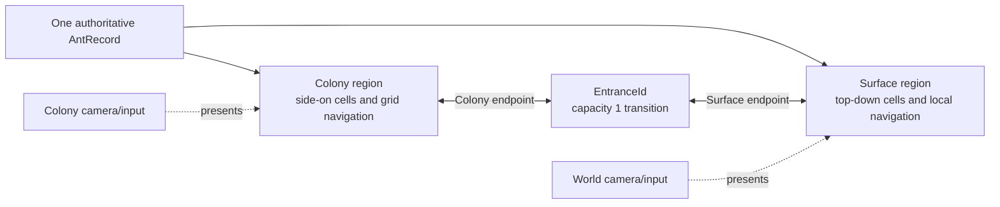
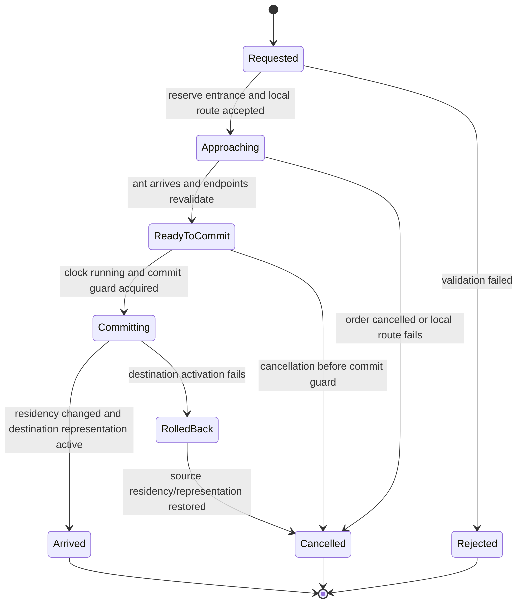
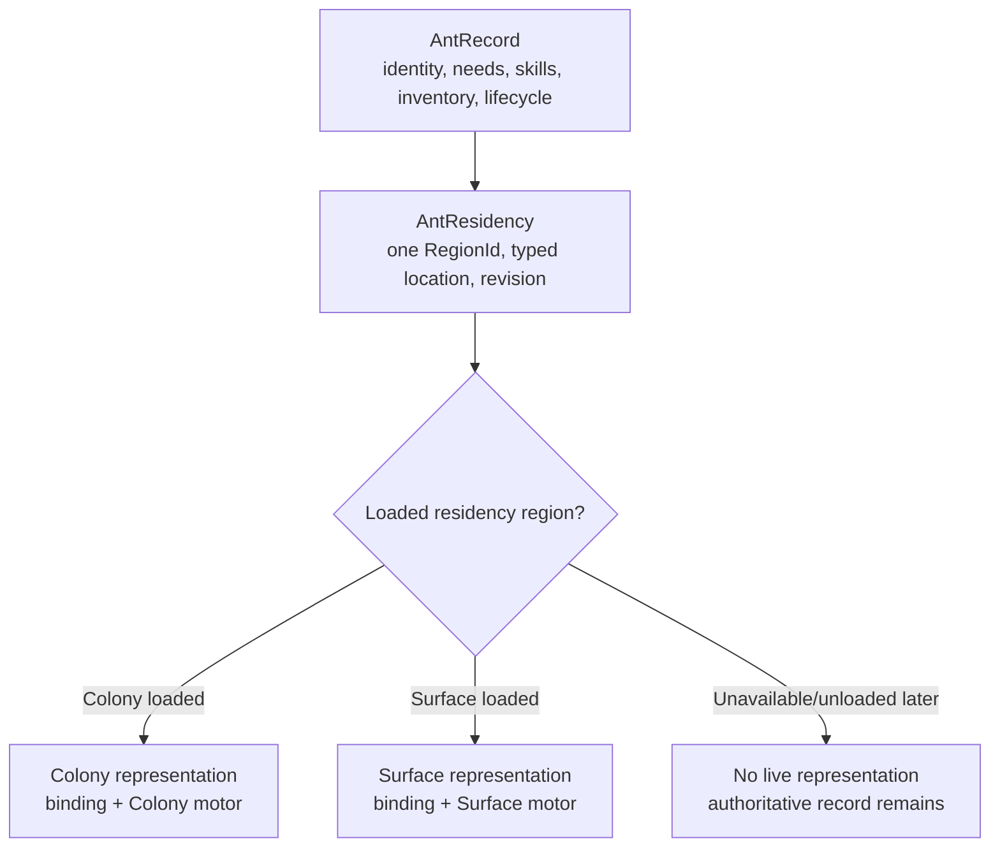
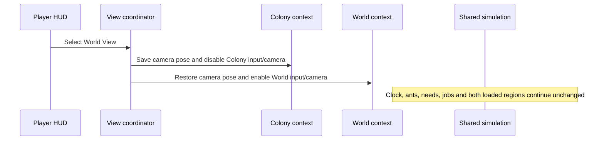
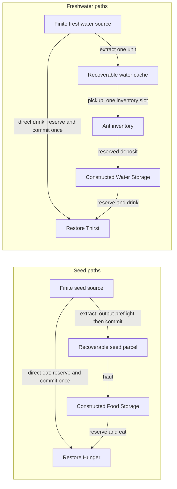

# Ant Colony WV-A — Two-View Technical Specification

## Resource and Node System v1.0 water amendment — 16 October 2026

[`ResourceAndNodeSystem.md`](ResourceAndNodeSystem.md) supersedes the earlier
first-slice water-source recommendation below where they conflict. Water is a
finite Resource Node, including when represented as a Solid. A Solid Water Node
uses whole-node depletion and commits its complete remaining quantity to a
liquid-compatible recoverable representation. It is never unlimited or
implicitly replenished.

Direct drinking and Extraction are distinct interactions but both must reserve
and reduce the same finite authoritative source exactly once. Whether direct
drinking is allowed to remove units from a still-solid multi-unit Node, or is
unavailable for a whole-node-only Solid Water definition, remains unresolved and
requires approval before WV-C implementation. The one-unit cache/payload model
below remains a useful compatibility proposal for physical liquid ownership,
not an approved limit on whole-node yield or permission to implement Water now.

## WV-B3A unified-cell integration clarification

`UnifiedRuntimeCellSpecification.md` defines the shared runtime occupancy and
mutation contract. It does not merge `ColonyCell` and `SurfaceCell`, either
local navigator, movement geometry, camera, renderer or the capacity-one
entrance/residency transaction. Surface obstacles will become a projection of
Surface cell state; Colony navigation remains a projection of Colony state.
Knowledge/Fog of War remains separate from physical cells. No WV-B3 runtime work
or WV-C1 interaction is implemented by this clarification.

## WV-B2B runtime relationship — 15 October 2026

The generated scenario supplies validated typed endpoints to the unchanged
capacity-one `NestEntranceTransitionService`; it does not use the authored WV-B1
coordinates. View changes remain presentation-only and never invoke generation.
The fixture continues using its authored endpoints. Generated Surface cells
adapt to `SurfaceWorldData`, while generated Colony cells adapt to
`ChunkedWorldData`; local navigators and residency authority remain separate.

## WV-B2A relationship — 15 October 2026

The approved generation-specific extension is
`ProceduralWorldGenerationSpecification.md`. It preserves this document's typed
regions, explicit endpoint mapping, single-residency rule, physical approach,
capacity-one/idempotent transaction, shared clock and region-specific rendering.
It supersedes only the old new-game assumption that the queen begins on the
Surface with no chamber: the generated founding queen now begins in one small
excavated Colony chamber beneath the top-boundary exit. WV-B1's existing authored
fixture and accepted transaction history remain unchanged.

The later WV-B2A unified-cell amendment establishes the same logical occupancy
slots in both regions: required natural Background plus optional
Solid/Resource Node, Construction/Placement and one-type loose stack. It does
not merge `ColonyCell`/`SurfaceCell`, local A*, movement or rendering. Natural
Surface sources and underground Solids use the shared node principle; the
entrance remains a specialised linked feature. Existing functional Background
content is legacy compatibility data pending an authorised placement migration.

## WV-B1 implementation record — 14 October 2026

**Implemented — Awaiting Validation.** WV-B1 approves and implements the proposed `64×64` Surface extent, logical origin `(0,0)`, one-unit cell scale, `32×32` future partition dimension, fixed obstacle-only fixture and eight-direction traversal with the documented no-corner-cut rule. Full chunk streaming is not implemented.

The runtime contracts use explicit readonly structs rather than the illustrative records shown below, preserving the same type separation. The initial scene packaging is a narrow coordinator attached to the existing development host: it keeps both regions loaded, creates temporary Surface presentation and a second camera, and does not rebuild Colony data. The first entrance uses Colony approach/arrival `(-1,-8)` / `(0,-8)` and Surface approach/arrival `(5,4)` / `(6,4)`.

One reversible deviation from the section 7 illustration is intentional: WV-B1 retains the same already-bound GameObject across a handoff and switches between disabled/enabled local motors instead of destroying and instantiating separate projections. This prevents duplicate live bindings while preserving the required authority order: residency revision commits first, representation activation is validated second, and failure restores source residency/pose. A future unload boundary may replace this adapter without changing `AntRecord`, residency or entrance contracts.

Surface movement has no gravity. Existing Colony grip/falling remains unchanged under the authoritative local-navigation rule in section 9; the later prompt sentence suggesting removal from both regions was treated as conflicting with the approved specification and was not used to rewrite accepted Colony behavior.

**Status:** Approved technical design, documentation only — 14 October 2026

**Runtime status:** Not implemented and not authorised for implementation

**Authority:** This document refines the approved design in `GameDesignDocument.md`. If they conflict, the GDD wins. `DevelopmentRoadmap.md` controls milestone authorisation and acceptance.

## 1. Scope and fixed decisions

WV-A defines an implementation-ready boundary between the existing side-on Colony View and a future top-down World View. It does not create runtime code, scenes, terrain, cameras, prefabs, resources or tests.

The following decisions are fixed for the first slice:

1. One pre-authored bidirectional nest entrance connects one Colony endpoint and one Surface endpoint. It admits one transitioning ant at a time.
2. The player switches views manually. Each view remembers its own camera position and zoom.
3. Ants travel to the entrance using their current region's navigation before any residency handoff.
4. The bounded starting surface contains finite nearby seed and freshwater sources.
5. Extracted water uses one-unit liquid payloads accounted for through the existing inventory ownership model, without pretending that water is an ordinary solid drop.
6. Safe natural rest is available before construction. A constructed Sleeping Background remains one-ant capacity and recovers Fatigue faster.

The Mara/Pip/Tala development world remains unchanged. Both initial regions will remain loaded when WV-B begins. Cross-view autonomous jobs, chunk streaming, unloaded simulation, predators, brood and reproduction are later work.

## 2. Current architecture audit

### Suitable integration points

| Existing system | Existing responsibility | WV integration use |
| --- | --- | --- |
| `AntRecord` | Persistent identity, colony, caste, attributes, skills, needs, priorities, inventory and lifecycle | Remains the single authoritative ant. Add residency beside or through an associated authoritative record, never to a view GameObject. |
| `AntRegistry` | Duplicate-safe colony-owned record lookup | Remains the identity lookup used by both regions. |
| `AntEntityBinding` / `AntEntityBindingRegistry` | A transient GameObject resolves one record; duplicate live visual claims are rejected | Reuse the claim invariant during representation handoff. A destination claim cannot coexist with a source claim. |
| `SimulationClockController` | Only gameplay clock; pause and 1×/2×/3× simulation speed | Drives both loaded regions, transitions, needs, jobs, retry deadlines and interactions. |
| `GameplayModeCoordinator` | Normal-gameplay autonomy policy independent from clock state | Continues to govern shared autonomy; view selection is not a gameplay-mode toggle. |
| `GridNavigationWorldService`, `GridPathfinder`, `GridNavigationMotor` | Colony-local map, bounded A* scheduling and movement execution | Remain unchanged as the Colony local-navigation implementation behind a future region-navigation boundary. |
| `ChunkedWorldData` / `WorldTileCoordinates` | Colony signed 32×32 chunks, local cells and integer-centre Unity mapping | Stay Colony-only. Their coordinate convention and two-layer terrain semantics must not leak into Surface types. |
| `ColonyJobRegistry` | Stable job identity, ownership, progress and cancellation | Its ownership/progress patterns are reusable. Its current `Vector2Int TargetCell` is Colony-local and must not be passed across regions. |
| `ConstructionJobs`, `WorldMaterialDrops`, `MaterialStorage` | Exact-once commits, physical ownership, reservation, cancellation and recovery | Reuse transaction patterns and resource conservation. Do not extend Soil/Stone drop types to imply liquid behavior. |
| `SurvivalInteractionWorld` / `AntNeedsState` | Constructed food/water/sleep targets, stable reservations and authoritative need mutation | Reuse need restoration and reservation semantics. Natural source records and natural rest require separate target kinds. |
| `PlayerHudController` | Presentation-only uGUI binding to existing authorities | Extend later with a narrow view selector and view context; do not make it a simulation owner. |
| `AntGameDevelopmentWorldHost` | Deterministic authored development composition | Preserve unchanged. WV-B should use separate authored composition rather than mutating this regression fixture. |

### Current single-Colony assumptions

- `PlayerViewContext` contains only `Colony`, and `PlayerHudController.CurrentView` always returns it.
- `AntSelectionCommandController` owns one camera, one `GridNavigationWorldService`, Colony cell conversion, Colony designation tools and a list of loaded `SelectableGridAnt` visuals.
- `SelectableGridAnt` combines the loaded Colony representation, current local motor and current order executor. It is not the persistent ant.
- Movement destinations, job targets, interaction cells, material drops and storage slots use unscoped `Vector2Int` values.
- `AntGameDevelopmentWorldHost` creates one bounded Colony world, one navigation service, one camera context and the three development ants.
- The roster can display authoritative records without visuals, but world selection and local orders require a loaded `SelectableGridAnt`.

These assumptions are valid for the implemented Colony slice. WV-B must add adapters and typed boundaries around them, not rewrite accepted Colony navigation or transactions.

### Historical contradictions and precedence

- Older `AGENTS.md` and roadmap passages describe a side-view-only game, direct WASD play or early milestones as current. The approved GDD sections dated 12–14 October 2026 supersede those passages; the old material is retained as history.
- The GDD's earlier unresolved questions about one entrance, manual camera switching, physical travel, nearby finite sources, one-unit water carriage and natural rest are resolved by the approved WV-A decisions. Only the narrower approval register in section 17 remains open.
- Later sections of `CurrentGameState.md` record old checkpoints that say general pathfinding, excavation or colony work is absent. The dated status sections at the top of that file and repository code are current.
- The wiki previously showed pre-correction survival rates. The 14 October balance correction and current `AntNeedsSimulationSettings` are authoritative.

## 3. Region identity and coordinate contracts

### Required value types

Suggested plain-C# contracts follow. Names are recommendations for WV-B, not production implementation in WV-A.

```csharp
readonly record struct RegionId(string Value);
readonly record struct EntranceId(string Value);
readonly record struct ResourceSourceId(string Value);
readonly record struct TransitionId(string Value);

readonly record struct ColonyCell(int X, int Y);
readonly record struct SurfaceCell(int X, int Y);

abstract record RegionLocation(RegionId RegionId);
sealed record ColonyLocation(RegionId RegionId, ColonyCell Cell)
    : RegionLocation(RegionId);
sealed record SurfaceLocation(RegionId RegionId, SurfaceCell Cell)
    : RegionLocation(RegionId);
```

`ColonyCell` and `SurfaceCell` must be different compile-time types. Neither implicitly converts to the other or to a generic `Vector2Int`. Unity conversion happens only inside the owning region adapter.

### Identity and location rules

- The initial Colony region has a stable ID such as `region.colony.founding-nest`.
- The initial Surface region has a stable ID such as `region.surface.founding-site`.
- A `RegionId` identifies simulation ownership, not which camera is active or which scene contains the representation.
- Colony cell centres remain at integer Unity world coordinates through `WorldTileCoordinates.CellToWorldPosition`. No WV work changes this convention.
- Surface coordinates are integer logical cells for deterministic records and path requests. Surface rendering may choose its own Unity transform and cell size.
- A region-scoped destination is a discriminated `RegionLocation`; APIs must pattern-match the concrete location before calling a local navigator.
- An entrance owns two typed endpoints. It is the only mapping between unrelated local spaces; there is no arithmetic Colony-to-Surface coordinate conversion.
- Ant residency persists as `AntId + RegionId + local location + residency revision`. Camera state never determines residency.

## 4. Initial surface foundation for WV-B

WV-B should create one deterministic bounded top-down region, not an enormous generated world.

| Choice | Recommendation | Approval state |
| --- | --- | --- |
| Playable extent | `64×64` logical Surface cells | **Requires approval in WV-B.** Large enough for movement, obstacles and nearby sources; small enough for deterministic tests. |
| Logical coordinate | Signed integer `SurfaceCell`; `(0,0)` is a stable authored origin | Recommended technical choice; exact origin placement requires WV-B approval. |
| Candidate chunk | `32×32` Surface cells, yielding four initial chunks | **Requires approval.** It aligns operationally with existing chunk tooling but does not share Colony data or semantics. |
| Generation | Fixed seed plus authored foundation layout containing entrance, obstacles and sources | Deterministic requirement approved; exact seed/layout requires WV-B approval. |
| Traversal | Occupied cells block; open cells permit top-down cardinal movement, with diagonals allowed only when both adjacent cardinals are open | **Requires WV-B approval.** No climbing, gripping, support or falling assumptions. |
| Expansion seam | Surface-region authority exposes bounded cell/chunk queries and treats absent chunks as unavailable | Required. Streaming remains deferred. |

The initial layout must include one stable entrance arrival area, at least two alternate local routes, representative blocking obstacles, finite seed and freshwater sources near but not on the entrance, and enough clear area to verify camera and movement. Custom World artwork remains an unbound presentation candidate until separate visual approval.

## 5. Region and entrance relationship



### Entrance record

```csharp
sealed record EntranceDefinition(
    EntranceId Id,
    ColonyLocation ColonyEndpoint,
    ColonyCell ColonyApproach,
    SurfaceLocation SurfaceEndpoint,
    SurfaceCell SurfaceApproach,
    int Capacity); // fixed at 1 for the first slice
```

The authoritative runtime entrance state additionally owns:

- availability: `Open`, `Blocked`, `SourceRegionUnavailable`, `DestinationRegionUnavailable`;
- at most one `TransitionId` reservation and owning `AntId`;
- source and destination endpoint revisions used for revalidation;
- a monotonically increasing transaction revision;
- readable failure/status information.

The interaction anchor is the local approach location from which an ant may enter. A valid source approach is resident, locally reachable, physically valid for the ant and adjacent/connected according to that region's rules. A valid arrival is resident, unblocked and suitable for representation activation; it is not merely the paired endpoint's raw coordinate.

## 6. Entrance transition transaction

### Required invariants

- Exactly one ant/`TransitionId` owns the entrance at a time.
- A transition changes only residency and loaded representation. It does not mutate inventory, needs, skills, lifecycle, job progress or physical resource ownership.
- The ant is never authoritative in two regions and is never absent from authoritative residency, including rollback.
- A failed transition finishes source-resident. A missing source visual is a presentation recovery problem, not permission to assign destination residency.
- Pause permits planning but prevents approach progress, commit, completion, retry expiry and occupancy-time advancement.
- A stable `TransitionId` can commit at most once; every repeated commit call returns its recorded terminal result.
- Cancellation and retry release ownership exactly once and cannot create a second residency or live visual.

### States



### Validation order

1. Resolve the request's `AntId`, `EntranceId`, source `RegionId` and expected residency revision.
2. Reject inactive/deceased/missing ants and source-region mismatch.
3. Reject while the simulation is paused for *progress*. A request may be authored and shown while paused, but it cannot reserve elapsed-time work, approach, enter `Committing` or complete.
4. Confirm the entrance is open, both regions are loaded/available, the source endpoint belongs to the ant's region and the paired destination is valid.
5. Acquire the capacity-one reservation with a new stable `TransitionId`; repeated submission of the same request returns the existing transaction rather than creating another.
6. Ask only the source region navigator for the approach route. No transition occurs on route acceptance.
7. On arrival, revalidate ant lifecycle, residency revision, ownership, both endpoints and destination arrival.
8. Acquire a one-shot commit guard keyed by `TransitionId`.
9. Quiesce the source motor/order representation. Preserve the `AntRecord`, inventory, needs, skills and job/order identity.
10. Change authoritative residency from source to destination once, incrementing its revision.
11. Release the source visual claim, instantiate/activate and bind the destination representation, then place it at the validated arrival.
12. If destination activation fails, restore source residency and representation before releasing the entrance. If restoration cannot instantiate, keep source residency authoritative and report an unloaded/no-visual state; never assign destination residency speculatively.
13. Mark committed and release occupancy. A second commit call for the same `TransitionId` is an idempotent no-op returning the recorded result.

### Cancellation and retry

- Cancellation during approach cancels only the local route, releases entrance occupancy and leaves source residency unchanged.
- Cancellation after the commit guard is acquired is deferred until commit or rollback reaches a stable residency; it cannot interrupt between removing and restoring ownership.
- Retry creates a new `TransitionId` only after the prior transaction is terminal.
- Use the existing bounded retry style: no per-frame polling. WV-B recommendation is at most two automatic arrival rechecks after short simulation-time backoff; exact delays require approval.
- Entrance occupancy contributes waiting, not a fake traversable local path. Manual orders may wait with feedback; autonomous cross-view route selection is deferred to WV-D.

## 7. Ant residency and representation



- `AntRecord` remains identity and shared gameplay state. Residency is an authoritative, persistent companion record keyed by `AntId`; it is not inferred from transforms.
- A loaded representation is a disposable projection that owns the active local motor and region-specific colliders/visuals.
- `AntEntityBindingRegistry` continues to prevent two live representations claiming one `AntId`.
- Selection is stored as `SelectedAntId`, not solely as a GameObject reference. Switching views keeps the same selected record.
- If the selected ant is not represented in the active view, the roster/inspector remains selected and shows its region plus a clear `Not in current view` state. World clicks cannot issue local orders to it until the player opens its region or chooses a region-scoped command supported later.
- A returning ant gets a new Colony representation bound to the same record and a Colony motor initialised at the validated arrival. It does not copy needs or inventory from the Surface representation.
- Transition while the player watches the other region uses the same transaction. Camera focus does not gate simulation or representation handoff.
- An ant becoming inactive during approach cancels normally. If it becomes inactive during guarded commit, the transaction first reaches a single stable residency and then disables the destination representation/order.
- Region load failure leaves the ant resident in the original region. Later unloaded simulation is deferred to WV-F.
- Removal/death during travel must first cancel route/transition ownership and release reservations. Carried physical resources remain on the authoritative record until a separately approved death/recovery transaction places them; they are never discarded by visual destruction.

## 8. Manual view and camera switching



The future view coordinator owns only presentation context:

- `ActiveView = Colony | World`;
- one remembered camera pose per view: position and orthographic size/zoom, clamped by that view;
- active camera, audio-listener and input-map/context enablement;
- HUD binding that hides Colony-only tools in World View and exposes only implemented World controls;
- optional `Focus selected ant's region` action, which is explicit and never automatic teleportation.

Switching views must not call pause/resume, issue/cancel an order, change ant residency, reset a region, rebuild records or alter autonomy. Colony Excavate/Build/Cancel designation tools are disabled and non-interactive in World View. Shared roster, ant details, needs, skills, inventory, priorities and clock remain visible from the same authorities. Do not restructure the accepted HUD beyond adding the selector/context binding needed by WV-B.

Input ownership is exclusive: only the active view converts screen positions to local coordinates or accepts world clicks. UI raycast blocking continues to protect camera and world input. Inactive view cameras and local input handlers are disabled, while their simulation services remain enabled.

## 9. Navigation responsibilities

### Local navigation

1. **Colony local navigation:** existing `GridNavigationWorldService`/`GridPathfinder`/`GridNavigationMotor`, existing cell centres, clearance, grip, falling and travel-time costs. No WV milestone changes these rules.
2. **Surface local navigation:** a future top-down navigator over `SurfaceCell`, surface obstacles and its own motor. It may share generic result vocabulary, but not Colony terrain data or graph nodes.
3. **Cross-view composition:** a future route planner joins local route estimates with an entrance edge. WV-B implements only direct travel to the single entrance and transition; autonomous composition is deferred to WV-D.

Suggested boundary:

```csharp
interface IRegionNavigator<TLocation>
{
    RouteEstimate Measure(TLocation from, TLocation to, AntId antId);
    LocalRouteHandle Request(TLocation destination, AntId antId);
    void Cancel(LocalRouteHandle route);
}

record CrossRegionRoute(
    RegionLocation Start,
    LocalRouteHandle Approach,
    EntranceId Entrance,
    RegionLocation Arrival,
    RegionLocation Destination);
```

Local costs use simulated travel seconds from the owning navigator. A future cross-view estimate is:

`source local travel + entrance interaction/wait estimate + destination local travel`.

Entrance waiting cost must be bounded and reported separately from geometric path cost. An occupied entrance may keep one accepted manual transition waiting, but WV-D must not allow unbounded retry or reserve multiple ants against capacity one. Endpoint invalidation cancels the affected local segment, preserves job/order identity and partial work, and returns a recoverable failure. Clock speed changes real-time completion rate, not simulated route cost; pause consumes no scheduler budget or retry time.

## 10. Shared simulation and loading

- `SimulationClockController` remains the only clock. Both loaded region services receive the same `DeltaSeconds`/`DeltaHours` and observe the same `IsRunning` state.
- Pause freezes both regions' movement, route scheduling, transitions, needs, skills, jobs, interactions, consumption, reservations with expiry, and retry/backoff advancement.
- 1×/2×/3× affects both regions equally. No region applies speed twice.
- Hidden-but-loaded regions continue full normal simulation. Camera activation is not a simulation activation flag.
- View switching does not reset records, motors, jobs, reservations or elapsed interaction work.
- Job reservations remain valid when their owning region is hidden. They are released only by the existing cancellation/failure/lifecycle rules.
- Initial WV-B keeps Colony and Surface loaded. There is no unloaded ant simulation in WV-B, WV-C1 or WV-C2.

WV-F will define a reduced-fidelity unloaded contract: stable entry snapshot, bounded deterministic catch-up, activities allowed while unloaded, route/travel accounting, resource commits and reconciliation on load. It must never claim to run full Rigidbody physics or per-frame navigation while unloaded.

## 11. Natural resource sources

```csharp
enum SourceDiscoveryState { Undiscovered, Discovered }
enum NaturalResourceKind { Seed, Freshwater }

sealed record NaturalResourceSource(
    ResourceSourceId Id,
    RegionLocation Location,
    NaturalResourceKind Kind,
    int RemainingUnits,
    SourceDiscoveryState Discovery,
    long Revision);
```

- Each source has stable identity, Surface region location, resource type, non-negative integer units, discovery state and reservation ledger.
- The initial seed and freshwater sources are finite and non-regenerating. This is the recommended first-slice rule and requires no recurring-world system.
- Undiscovered sources exist physically but are omitted from normal job selection/UI. Discovery changes only discovery state; it does not remove quantity or create inventory.
- Discovered availability requires `RemainingUnits - reserved units > 0`, a loaded/available region and a reachable valid interaction anchor.
- Reservations are source-owned, quantity-bounded and keyed by stable operation/ant identity. Two ants cannot reserve the same unit.
- Commit decrements source quantity exactly once under an operation key. At zero the source is Depleted and rejects new reservations.
- Visibility is presentation derived from discovery; reachability is navigation derived. Neither changes quantity.
- Source regeneration is **none for WV-C**. Any future regeneration requires a separate ecological/balance decision.

## 12. Food interaction contract

### Direct consumption

1. Reserve one available seed unit under a stable consumption operation.
2. Navigate to a valid source interaction anchor.
3. Revalidate source identity, revision, reservation, ant lifecycle and need eligibility.
4. On the shared clock, complete the interaction and atomically decrement the source once before applying the existing hunger restoration rule once.
5. Record terminal operation state so repeated callbacks cannot consume or restore twice.

No loose item, inventory slot or storage is required. Cancellation before commit releases the seed reservation. Cancellation after commit does not refund hunger or recreate the seed.

### Extraction

Extraction is distinct from eating. A supported future extraction job reserves source quantity, performs work at the source and atomically changes reserved source units into a stable, recoverable **seed parcel** at the source/validated output location. It never auto-fills inventory. Later hauling reserves and picks up the parcel; compatible constructed Food Storage accepts it through a resource transfer transaction. If output cannot be represented, source quantity remains unchanged. Cancellation preserves source quantity or already-committed output, never both.

Solid seed parcels may adopt a future generic resource-parcel registry patterned after `WorldMaterialDropRegistry`; they must not masquerade as Soil/Stone `ExcavatedMaterialType` values.

## 13. Water interaction and transport contract

Direct drinking, if approved for a given Water Node definition, follows the same
exact-once source reservation and need-restoration sequence as food and requires
no Storage. It must reduce finite source quantity. Its compatibility with the
whole-node rule for a Solid Water Node is explicitly unresolved.

The earlier WV-A proposal used a **one-unit recoverable liquid payload** with a
stable `LiquidPayloadId`. Resource and Node v1.0 instead requires Extraction to
represent the complete whole-node yield, potentially through several bounded
liquid-compatible caches/carriers or a recoverable pending-output transaction.
Water is not an ordinary Soil/Stone loose stack.

```csharp
enum LiquidOwnerKind { ReservedSource, GroundCache, AntInventory, WaterStorage }

sealed record LiquidPayload(
    string PayloadId,
    string ResourceId, // freshwater
    int Quantity,      // exactly 1
    LiquidOwnerKind OwnerKind,
    string OwnerId,
    RegionLocation Location,
    long Revision);
```

Candidate physical representation: bounded **water cache** records at validated
traversable interaction anchors, each with stable identity and future visible
presentation. A cache is not a terrain Solid or Soil/Stone stack and is
recoverable by Hauling. Capacity, container semantics and art require approval.

Ownership changes atomically along one chain:

`Freshwater source reservation → ground water cache → ant inventory slot → constructed Water Storage slot → drinking reservation/consumption`.



- Extraction decrements the source only if the ground cache can be committed.
- Pickup moves exactly one payload into one available ant slot; maximum stack is one. Source/cache ownership is removed only after inventory ownership succeeds.
- A carrier interruption leaves water in inventory. If a later action explicitly releases it, the transaction creates a valid ground cache first and removes inventory ownership second.
- If no valid release location exists, the ant retains the payload and reports blocked; water never vanishes.
- Deposit reserves one compatible Water Storage capacity, travels, revalidates, commits storage ownership and then clears inventory.
- Drinking from storage reserves and consumes one stored unit exactly once through existing survival need mutation.
- Cancellation releases only uncommitted reservations. The payload remains with its current authoritative owner.
- Ant lifecycle removal while carrying requires a recovery transaction before inventory disposal; death/corpse behavior remains a later decision.

## 14. Natural resting contract

A natural rest target is a transient reservation at a safe local pose, not a new functional Background or room capacity.

Validation requires:

- region is loaded and the pose has full ant-body clearance;
- local movement rules consider the pose stable: Colony uses Grounded or valid natural grip; Surface uses a traversable non-hazard cell;
- the ant can route to the pose;
- the pose is not an entrance approach/arrival, resource interaction anchor, active work anchor or blocking occupancy;
- no other ant owns the natural-rest reservation for that pose;
- the pose remains safe on arrival and throughout rest.

Rest is interrupted by player order, critical Hunger/Thirst, lifecycle change, terrain/obstacle invalidation or cancellation. Applied Fatigue recovery is retained; the reservation releases exactly once. Ordinary work does not begin while actively resting.

Provisional balance recommendation for later approval:

| Rest type | Fatigue recovery | Capacity |
| --- | ---: | --- |
| Safe natural rest | `8` Fatigue per simulation hour | One reservation per validated pose |
| Constructed Sleeping Background | Existing `16` Fatigue per simulation hour | One dedicated ant per tile |

This makes constructed sleep twice as efficient while preserving the current accepted constructed recovery value. Exact natural rate requires WV-C1 approval. No room score, enclosure requirement or new functional capacity is introduced.

## 15. Founding queen bootstrap (new-game location superseded by WV-B2A)

The future generated new-game scenario contains one active founding queen in one
small excavated underground starting chamber beneath the known top-boundary
Colony exit. It has no constructed storage/sleeping/nursery tiles. The linked
Surface contains finite nearby food and freshwater sources and supports safe
natural rest. The surrounding Colony remains solid and excavatable. Exact
generation geometry and source-record rules are owned by
`ProceduralWorldGenerationSpecification.md`.

Minimal opening sequence:

1. The paused game introduces the queen in the valid starting chamber and the
   known linked entrance.
2. The queen reaches the Colony approach and transfers through the capacity-one
   transaction.
3. The Surface arrival can reach nearby discovered or readily discoverable
   sustenance; the player can direct/permit direct eating, drinking and natural
   rest without storage.
4. She excavates Soil; exact-once extraction leaves physical loose Soil without requiring inventory or storage.
5. Hauling delivers loose construction material to staged sites; the queen then
   performs Construction work for initial Sleeping and Storage Placements. The
   current functional-Background result remains compatibility implementation.
6. Surface seed/water extraction and hauling can then stock constructed Food/Water Storage.
7. Nursery and brood follow only in a later authorised milestone.

This avoids the circular dependency: survival is possible directly at natural sources and natural rest positions; excavation output can remain loose; construction can collect loose material directly; storage improves logistics but is not a prerequisite for obtaining its own construction materials.

## 16. Failure and recovery matrix

| Case | Authoritative ownership/state preservation | Retry policy | User feedback |
| --- | --- | --- | --- |
| Transition requested while paused | Request may be displayed; ant, residency and entrance remain unchanged; no progress/commit | Resume continues/revalidates; no timer advances | `Waiting for simulation` |
| Entrance occupied | Current transaction retains sole ownership; waiting ant remains in source region | Bounded simulation-time recheck or manual retry | Name entrance and current wait state |
| Entrance blocked | No transition ownership commits; source route/order remains recoverable | Retry only after state revision/change | `Entrance blocked` |
| Destination unavailable | Ant stays in source region with record/inventory intact | Retry after region becomes available | `Surface/Colony region unavailable` |
| Arrival occupied/invalid | Ant stays source-resident; source representation remains/restores | Up to two bounded arrival rechecks, then fail | `Arrival unavailable` |
| Cancel during approach | Cancel source local route and release entrance | New request allowed after terminal cancellation | `Travel cancelled` |
| Cancel during transition | Finish guarded commit or rollback before applying cancellation | No mid-commit retry | `Finishing safe handoff` then terminal result |
| Ant becomes inactive | Cancel approach; during commit reach one stable residency then disable representation | No automatic retry while inactive | Lifecycle reason |
| Destination representation fails | Roll back to source residency; restore source visual if possible; record may temporarily have no visual but one residency | Retry only after load/instantiation recovery | `Could not enter destination` |
| Source exhausted during interaction | Existing reservation may commit if still valid; unreserved request fails | Re-evaluate other sources with bounded backoff | `Source depleted` |
| Two ants reserve same seed/water unit | Source ledger grants unit to only one owner | Loser selects other unreserved quantity/source later | `Resource already reserved` |
| Water hauling interrupted | Payload remains in current owner: cache, inventory or storage reservation source | Resume same haul or cancel and release reservation | Show payload owner/location |
| Extraction output cannot be represented | Source retains quantity; no payload/parcel created | Fail until representation capacity/location changes | `No safe recoverable output location` |
| Repeated consume callback | Stable operation key returns terminal result; no second decrement/restoration | None | No duplicate notification; diagnostics record replay |
| Camera switches during travel | Ant route, job, reservations, needs and residency continue | None caused by view switch | Roster shows region/activity |
| Hidden loaded region working | Full simulation continues from shared clock | Normal job retry rules | Global roster/job UI stays current |

## 17. Acceptance strategy

### WV-B — bounded surface, manual views and one entrance

**Edit Mode**

- Typed Colony and Surface locations cannot be interchanged by API.
- Deterministic `64×64` candidate layout and absent-chunk unavailable behavior.
- Entrance IDs/endpoints validate uniqueness and region pairing.
- Transition state machine enforces capacity one, idempotent commit, rollback and residency revision checks.
- Same `AntRecord` reference/ID, exact inventory and needs before/after round trip.
- Paused request cannot approach, transition, consume retry time or commit.
- Region residency and live binding uniqueness through repeated cancel/retry.

**Play Mode**

- Switch views repeatedly; each camera restores position/zoom independently.
- Switching never changes clock state, issues an order or moves an ant.
- Colony tools are unavailable in World View.
- Ant physically approaches from each region, transfers once and returns.
- Both loaded regions advance from one clock at 1×/2×/3× and freeze together.
- Destination representation failure rolls back without duplicate/lost ant.
- Existing Colony navigation, excavation, construction, HUD and Mara/Pip/Tala tests remain green.

**Manual**

- Verify top-down readability/input, camera memory, inactive-view input isolation and clear off-view selection status.
- Observe capacity-one waiting and cancellation at the entrance.
- Confirm no teleport occurs merely by clicking/switching views and Console stays clean.

### WV-C1 — finite sources, direct survival and natural rest

**Edit Mode:** stable source identity/discovery; finite quantity; exclusive reservations; exact-once direct consumption; depletion; safe-rest validation/reservation/interruption; constructed sleep faster than natural rest; no storage prerequisite.

**Play Mode:** discover finite seed/water; direct eat/drink; exhaust a source; natural rest on valid Colony and Surface poses; reject unsafe/occupied/entrance poses; hidden-region needs and interactions continue; pause/speeds remain consistent.

**Manual:** complete the founding queen survival loop without constructed facilities, verify clear source/depletion/rest feedback and confirm existing constructed interactions still behave unchanged.

### WV-C2 — extraction, liquid payload and storage loop

**Edit Mode:** seed extraction conserves source/output; one-unit water cache ownership; pickup/deposit/release exact conservation; cancellation at each phase; storage reservation exclusivity; repeated commit idempotence; unrepresentable output preserves source.

**Play Mode:** extract seed and water to visible recoverable outputs; haul to constructed Food/Water Storage; drink/eat from storage; interrupt water carrying; recover a released cache; verify source + cache + inventory + storage + consumed totals.

**Manual:** run the full queen surface-to-colony supply loop with no starting storage, inspect ownership through interruptions/view changes and confirm no solid-block treatment for water.

No Unity tests are required for WV-A because it changes documentation only. Future milestones must record compilation, Edit Mode, Play Mode and manual acceptance separately.

## 18. Remaining approvals

The following choices remain intentionally open:

1. WV-B1 approved and implemented the initial `64×64` Surface extent, `(0,0)`
   origin, one-unit cells, `32×32` future partition, diagonal movement and fixed
   obstacle rules for its development fixture. WV-B2A separately owns future
   generated-layout rules.
2. WV-B1 uses the existing authored development composition. A future generated
   scenario must preserve current Bootstrap/host boundaries and explicit
   scenario selection.
3. Entrance approach/arrival animation, transition duration and exact retry delays (capacity one and atomic guarantees are fixed).
4. Whether the initial nearby sources begin discovered or require one explicit discovery action.
5. Seed parcel stack size and Food Storage transfer quantity.
6. Player-facing name/art for the one-unit water cache and confirmation that it consumes one inventory slot.
7. Natural-rest recovery (`8/hour` recommended) and exact Surface safety/hazard rules.
8. Direct seed/water restoration amounts if they differ from the existing provisional `40 Hunger` / `50 Thirst` values.
10. Save/version schema. Persistence is required eventually but is not part of WV-B/C implementation.

These are balancing, presentation or packaging choices. They do not reopen the approved two-view, entrance, physical-travel, finite-source, one-unit water or natural-rest decisions.

## 19. Recommended smallest WV-B milestone

Implement **WV-B1: typed two-region foundation and manual presentation switch** only:

- add stable Region/Entrance/location contracts and residency data;
- author one deterministic bounded Surface fixture with one entrance and obstacle-only top-down movement;
- add a separate Surface representation/motor and a thin region-navigation adapter;
- add manual uGUI view switching with independent camera memory and strict input contexts;
- implement capacity-one bidirectional transition with rollback/idempotence;
- keep both regions loaded on the one simulation clock;
- add no natural resources, extraction, hauling, storage changes, autonomous cross-view routing, streaming or unloaded simulation.

Stop after WV-B1 acceptance before starting WV-C1 or WV-C2.
