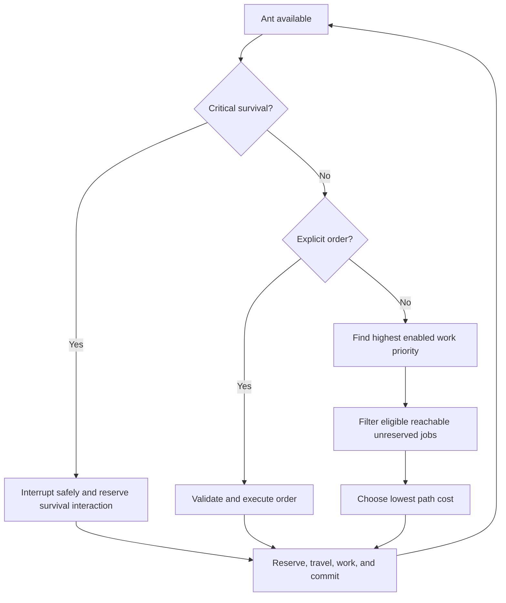

# Ant AI and Job Management

## Unified resource-job eligibility

Extraction, Hauling and Construction are distinct shared-registry jobs.
Extraction always creates loose output. Hauling is eligible only when an
unreserved transferable source and reachable reservable Construction Site or
Material Storage destination both exist; pending construction staging is chosen
before optional Storage. Construction is eligible only when its site is fully
staged. Failed dependencies remain pending/unowned and are reconsidered when
physical state changes, preventing rejected-job loops without another scheduler.

## WV-B1 region boundary

WV-B1 does not add autonomous cross-view routing or Surface jobs. Existing survival and Colony-work evaluators continue to advance persistent ant needs from the shared clock, but they issue Colony-local navigation/work only when the ant's authoritative residency is the Colony region. A Surface-resident ant can receive direct player Surface movement or a manual entrance request; it cannot accidentally claim a Colony `Vector2Int` destination from the inactive view. Existing Colony jobs and reservations are not reset by camera switching or representation handoff.

## Approved job model

Future autonomous work uses a per-ant matrix of priorities `1–4` plus **Disabled**. The highest eligible priority wins before the closest reachable job by path cost. Skills change efficiency; they do not override player-assigned priority.

Ants may also receive temporary explicit orders. Critical survival may interrupt ordinary work at a safe point. Valid partial progress persists, and exclusive reservations prevent two ants from consuming or owning the same work target. Drafted survival intervention remains unresolved.

## Current implementation

Milestones through 3.3D are accepted, and 3.4A extends that foundation with physical Background construction:

- Every ant record owns independent priorities for Excavation, Surface Preparation, Construction, Hauling, Foraging, Production, Combat, and Brood Care.
- `ColonyJobRegistry` owns synthetic job identity, target, status, reservation, progress, and failure state outside GameObjects.
- Highest enabled priority is evaluated before actual A* route cost. Equal costs use stable deterministic ties.
- Evaluations inspect at most 32 candidates per priority, are staggered, and back off for 2/4/8 seconds on failure.
- `SyntheticColonyJobOrder` remains as a regression fixture. Real designations use `ExcavationJobOrder` through the same registry, selector, motor, adjacency, priority and interruption seams.
- Extract mode accepts eligible foreground Resource Nodes by world coordinate, supports bounded area drags, and blocks ordinary selection/orders while active.
- Soil and Stone extraction uses a stable job-keyed transaction. The complete yield always becomes loose output at the excavated cell; excavation never mutates inventory or assigns hauling. Output failure preserves the Solid; successful removal preserves Background and refreshes one visual/collision/navigation locality.
- Work takes a provisional four simulation hours, uses Rested and relevant-skill speed, and awards proportional XP only for committed progress.
- Player orders and critical survival pause work and release ownership while preserving progress. Ordinary survival waits for active work.
- Explicit player pickup reserves one loose drop quantity and travels through the same shared navigation/adjacency seam. This is an order, not an autonomous Hauling job.
- Autonomous Hauling jobs reserve loose source quantity and compatible Material Storage capacity, then use the same motor to visit valid adjacent source and destination anchors. Already-carried Soil/Stone creates an owner-only self-deposit task.
- Dynamic Hauling performs a read-only source, carrying-capacity, route and compatible-destination check before autonomous selection. A compatible Construction Site is valid without Storage; otherwise the haul remains paused/unowned and leaves the loose source unreserved. It is reconsidered when staging or Storage capacity changes.
- Actual A* travel cost selects the closest reachable compatible storage with deterministic ties. Disabled Hauling blocks dynamic claims; critical survival and explicit player orders interrupt safely.
- The development scene exposes deterministic job, excavation and loose-drop fixtures plus priority, inventory, cancellation, reset, and diagnostic controls.
- Background Conversion designations create real Construction jobs. The exclusive builder uses inventory first, otherwise reserves reachable storage/drop material, stages it at the site, performs timed work and commits the Background transaction.
- Autonomous selection screens construction for obtainable physical material before it reserves an ant. A job with no carried, reachable stored or reachable unreserved loose material remains paused and unowned with an explicit waiting reason, allowing lower-priority eligible work to proceed. The same job is reconsidered when material becomes reachable.
- A construction builder with no usable inventory capacity temporarily unloads unnecessary cargo through a reusable recovery operation: closest reachable reserved storage first, validated recoverable current-anchor drop second, then automatic resumption of the same job. Critical survival and player orders may interrupt this state safely.
- Construction interruption preserves progress, carried material and staged material. Cancellation releases reservations and exposes staged material as a recoverable drop.

Foraging discovers resource locations, Extraction physically removes resource nodes, Hauling collects/transports loose material to staging or Storage, and Construction performs fully staged work. Extraction is the authoritative runtime work category; `Excavation*` type names are compatibility seams.

Milestones 3.4A, 3.4B and 3.4C are manually accepted. Milestone 3.4D is **Implemented — Pending Manual Acceptance**. Its global player-facing matrix lists active authoritative ant records whether or not their Colony View visual is loaded. Extraction, Construction and Hauling are the functional columns. Cells display mapped skills and edit the existing record-owned 1–4/Disabled values; developer diagnostics read the same values.

Changing a matrix value resets subsequent autonomous evaluation but never cancels an active job, changes a skill, pauses simulation or changes a developer autonomy override. Current activity and real failure/waiting text are displayed where the existing agent/job state exposes them. Surface Preparation, Foraging, Production, Combat and Brood Care stay out of the functional player matrix until real executors exist.

## Future decision flow

## Required architecture boundaries

- Job choice must not live in UI code.
- Navigation calculates routes; it does not decide why an ant travels.
- Work progress and physical resources remain authoritative outside visuals.
- Cancellation and interruption must release reservations exactly once.
- Construction remains distinct and begins only after Hauling completes staging.
- Hundreds-of-ants goals require controlled update rates and shared data, but do not justify DOTS/ECS before profiling.

## Future cross-region work boundary

WV-A preserves the active job/order identity and valid partial work while an ant changes regions. A cross-view destination is region-scoped and composes a source-local route, one capacity-one entrance transaction and a destination-local route. The current Colony `Vector2Int` job targets and A* service remain unchanged; they are not valid Surface coordinates. An occupied or invalid entrance produces a recoverable waiting/failure state and releases reservations only through the owning job's existing cancellation rules. Autonomous cross-view selection and cost comparison are deferred to WV-D. See [World View Foundation](world-view-foundation.md).

## Not implemented

Excavation, personal inventory, explicit pickup, Material Storage, autonomous Soil/Stone hauling and functional Background construction are now real. Gathering, production, combat, brood care, forced-work orders, Draft Mode, group tactics, local avoidance, persistence, rooms and production-scale indexing require later milestones.
