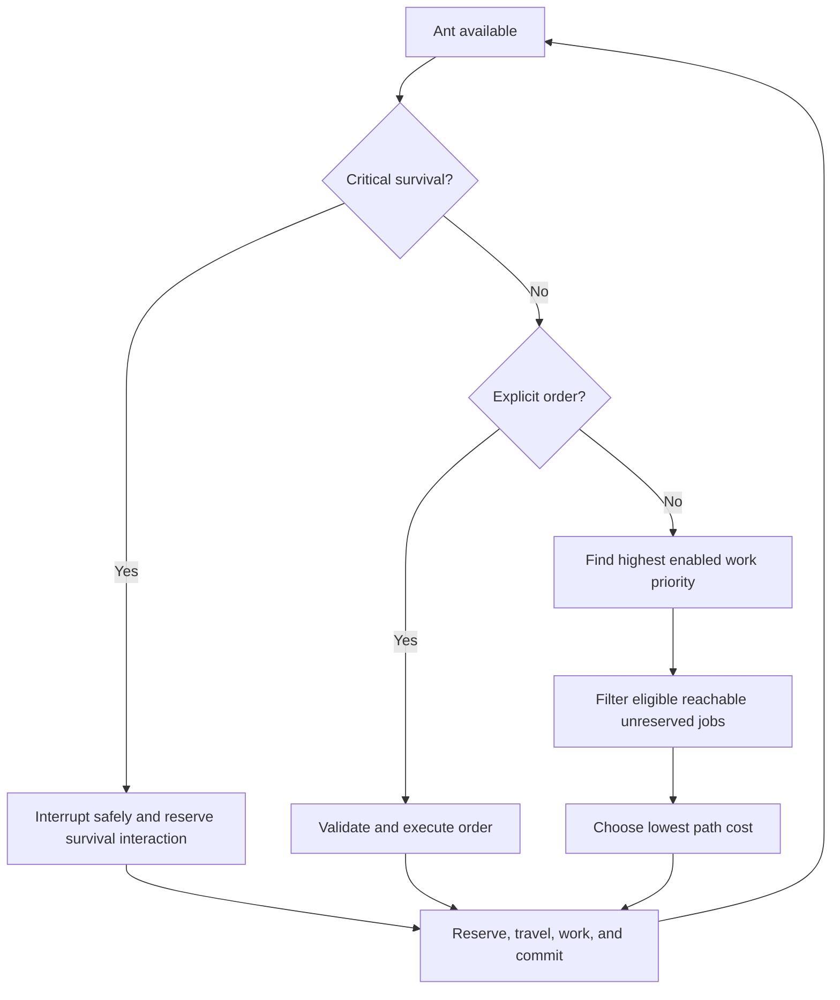

# Ant AI and Job Management

## Approved job model

Future autonomous work uses a per-ant matrix of priorities `1–4` plus **Disabled**. The highest eligible priority wins before the closest reachable job by path cost. Skills change efficiency; they do not override player-assigned priority.

Ants may also receive temporary explicit orders. Critical survival may interrupt ordinary work at a safe point. Valid partial progress persists, and exclusive reservations prevent two ants from consuming or owning the same work target. Drafted survival intervention remains unresolved.

## Current implementation

Milestones through 3.3C are accepted, and 3.3D extends that foundation with physical storage and autonomous hauling:

- Every ant record owns independent priorities for Excavation, Surface Preparation, Construction, Hauling, Foraging, Production, Combat, and Brood Care.
- `ColonyJobRegistry` owns synthetic job identity, target, status, reservation, progress, and failure state outside GameObjects.
- Highest enabled priority is evaluated before actual A* route cost. Equal costs use stable deterministic ties.
- Evaluations inspect at most 32 candidates per priority, are staggered, and back off for 2/4/8 seconds on failure.
- `SyntheticColonyJobOrder` remains as a regression fixture. Real designations use `ExcavationJobOrder` through the same registry, selector, motor, adjacency, priority and interruption seams.
- Excavate mode accepts eligible foreground Solids by world coordinate, supports bounded area drags, and blocks ordinary selection/orders while active.
- Soil and Stone completion uses a stable job-keyed transaction. Output enters the excavator's inventory when possible, with any remainder becoming a recoverable drop. Output failure preserves the Solid; successful removal preserves Background and refreshes one visual/collision/navigation locality.
- Work takes a provisional four simulation hours, uses Rested and relevant-skill speed, and awards proportional XP only for committed progress.
- Player orders and critical survival pause work and release ownership while preserving progress. Ordinary survival waits for active work.
- Explicit player pickup reserves one loose drop quantity and travels through the same shared navigation/adjacency seam. This is an order, not an autonomous Hauling job.
- Autonomous Hauling jobs reserve loose source quantity and compatible Material Storage capacity, then use the same motor to visit valid adjacent source and destination anchors. Already-carried Soil/Stone creates an owner-only self-deposit task.
- Actual A* travel cost selects the closest reachable compatible storage with deterministic ties. Disabled Hauling blocks dynamic claims; critical survival and explicit player orders interrupt safely.
- The development scene exposes deterministic job, excavation and loose-drop fixtures plus priority, inventory, cancellation, reset, and diagnostic controls.

Milestones through 3.3C are accepted. Milestone 3.3D is **Implemented — Pending Manual Acceptance** with 15/15 focused Edit, 3/3 focused Play, 447/447 full Edit and 45/45 full Play passing.

## Future decision flow

## Required architecture boundaries

- Job choice must not live in UI code.
- Navigation calculates routes; it does not decide why an ant travels.
- Work progress and physical resources remain authoritative outside visuals.
- Cancellation and interruption must release reservations exactly once.
- Construction preserves builder self-supply.
- Hundreds-of-ants goals require controlled update rates and shared data, but do not justify DOTS/ECS before profiling.

## Not implemented

Excavation, personal inventory, explicit pickup, Material Storage and autonomous Soil/Stone hauling are now real. Surface Preparation, construction, gathering, production, combat, brood care, forced-work orders, Draft Mode, group tactics, local avoidance, persistence, and production-scale indexing require later milestones.
