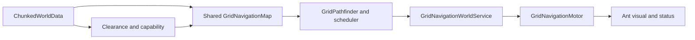

# Ant Movement and Navigation

Movement and navigation are the most extensively implemented and tested foundations in the project. They deliberately separate world truth, movement capability, route planning, and motor execution.

The established grip/support/falling rules describe the side-on underground **Colony View**. WV-B1 now also implements a separate top-down Surface navigator; the two local graphs and coordinate types are not interchangeable.

## WV-B1 Surface-local movement

`SurfaceWorldData` owns a bounded deterministic `64×64` obstacle grid, independently of `ChunkedWorldData`. `SurfacePathfinder` performs bounded deterministic A* over `SurfaceCell`: cardinal and diagonal steps are allowed, but a diagonal is rejected unless both adjacent cardinal cells are open. `SurfaceNavigationMotor` follows those cells kinematically from the shared simulation-clock delta, so pause freezes it and 1×/2×/3× remain compatible. It has no gravity, grip, excavation or falling states.

`TwoViewWorldCoordinator` accepts Surface pointer conversion only while World View is active. Colony orders are rejected for Surface residents, and Colony designation input is disabled in World View. Entrance travel asks only the source region's local motor to reach its typed approach cell; there is no autonomous cross-region pathfinder in WV-B1.

## Authoritative rules

- Every resident coordinate has one Background Tile and at most one foreground Solid Tile.
- A blocking Solid prevents occupancy; excavation will remove only eligible foreground material.
- Exposed natural Earth and Stone Backgrounds are grippable at normal speed.
- Prepared Background grants the same access with a provisional `1.25x` movement-speed multiplier.
- Sky is non-grippable; without ground or grip an ant can fall.
- Full-body clearance is separate from grip, grounding, traversability, and reachability.
- Valid diagonal connections cannot cut blocked corners.
- Stable movement follows shared navigation; Rigidbody2D gravity is reserved for Falling.

## Production flow

`GridNavigationWorldService` is the per-world owner of the shared map and bounded scheduler. `GridNavigationMotor` exposes the narrow destination, cancellation, and status boundary used by selection and survival interactions. The command layer does not implement a competing movement system.

Milestone 3.4B binds the service to the scene simulation clock. While paused, the scheduler consumes no request/node budget and fixed-step motors, climbing and Rigidbody2D falling do not run because `Time.timeScale` is zero. Pending requests and active routes remain owned and resume unchanged. The original `fixedDeltaTime` and `maximumDeltaTime` remain constant at 1×/2×/3× and are restored after the clock component is disabled or destroyed.

## Implemented milestones

| Area | Status | Evidence summary |
| --- | --- | --- |
| Chunked two-layer world | Complete | Signed chunks and missing-world behavior tested |
| Classification and visualisation | Complete | Automated and manual visual acceptance recorded |
| Collision projection and body clearance | Complete | Physics-backed and manual checks accepted |
| Natural grip, prepared speed, gravity | Complete | 56/56 focused Edit Mode, 227/227 full Edit Mode, 6/6 Play Mode plus manual acceptance |
| Grid-navigation proof of concept | Complete | A*, smooth following, falling/recovery, and performance evidence accepted |
| Shared scheduling and multi-ant readiness | Complete | Bounded fair scheduling and 1/100/300/500 request batches validated |
| Production grid integration | Implemented — Pending Manual Acceptance | Static compilation and later suites passed; its dedicated manual checklist remains open |
| Selection and independent move orders | Complete | 6/6 focused Edit Mode, 4/4 focused Play Mode, 258/258 full Edit Mode, 18/18 full Play Mode plus manual acceptance |

## Known limitations

- Friendly overlap is currently intentional; local avoidance and congestion behavior are future work.
- The current grid is a deterministic authored development world, not procedural streaming gameplay.
- General multiple-ant traffic, reservations, and deadlock handling are not complete gameplay systems.
- The older `AntSurfaceMotor` and `PlayerMovementInput` course remains for regression testing. It is not the normal control model.
- The original movement prototype still has pending ceiling, complete-corner-route, Auto Step-Over, and camera-follow completion work; that does not invalidate the accepted grid-navigation milestones.

## Future World View navigation

World View will use top-down surface movement over its own explicit coordinate and chunk space. It may use different local connections, obstacles and movement presentation from Colony View. The established underground grounded/gripping/climbing/falling rules remain valid in Colony View and must not be simplified to make both views use one local motor or path graph.

WV-A defines cross-view travel as:

1. a Colony View route to a valid nest entrance;
2. one controlled residency/representation transition; and
3. a World View route from the paired surface entrance.

The same authoritative ant, inventory, needs, job and reservation state continues through all three stages. Only one live movement representation may own the ant at a time. The initial entrance has capacity one. A transaction reserves it, revalidates the destination and commits one residency revision idempotently; failure restores source residency. Local cost is simulated travel time, while future total cost adds an entrance wait/interaction estimate and destination-local travel. Autonomous composition remains deferred to WV-D.

Hidden loaded regions continue using the shared simulation clock. Future unloaded chunks require reduced-fidelity travel and job simulation rather than full physics or per-frame path execution. The reconciliation rules for an ant that returns to a loaded chunk must be deterministic and must not duplicate distance, work, resources or elapsed needs.

WV-B should introduce a separate `SurfaceCell` and Surface-local navigator. It must not pass a Surface coordinate to `GridPathfinder`, reuse Colony grip/falling edges for top-down movement or generalise `GridNavigationMotor` until a demonstrated shared abstraction exists. See [World View Foundation](world-view-foundation.md).

## Future acceptance

Dynamic excavation and functional conversion must locally invalidate affected Colony View navigation data. Future Colony View agents must use the same route and motor rules; they cannot teleport, fly through unsupported space, or bypass clearance because a task system requested it. Future World View agents require equally explicit surface rules, while cross-view travel must pass through a valid entrance rather than bypassing either local navigation system.

Future diagram or screenshot: grid anchors, prepared-speed region, falling transition, and an invalidated route after terrain mutation.

