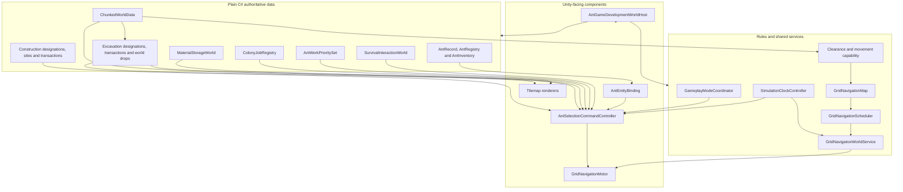

# Technical Architecture

## Project shape

- Unity `6000.3.8f1`
- 2D Universal Render Pipeline
- New Input System
- C# runtime code under `Assets/AntColony/Scripts/`
- Edit Mode and Play Mode tests under `Assets/AntColony/Tests/`
- Authored scenes and prefabs under `Assets/AntColony/`
- No networking package; the game is single-player

The project preserves an authored-content-first approach. Scene and prefab references remain explicit, while plain-C# models own game state where Unity components are unnecessary.

## Runtime ownership

### Ant data

`AntColony.Ants` owns stable identity, colony membership, caste, attributes, lifecycle, skills, needs, per-ant work priorities and stack-based personal inventory. Runtime visuals bind to records rather than becoming the source of truth.

### World data

`AntColony.World` owns chunks, Background/Solid material definitions, loose material drops, physical Material Storage slots, the atomic excavation commit, classification, clearance, capability, pathfinding data, and scheduling. Visual and collision Tilemaps project that data through `AntColony.WorldPresentation`; they do not own stored quantities.

### Navigation

One `GridNavigationWorldService` owns the shared navigation map and bounded scheduler for a world. Each `GridNavigationMotor` owns only its agent request and execution state. Command and interaction systems call the narrow motor API.

### Commands and interactions

`AntColony.Commands` handles selection, designation input, context orders, visual bindings, physical survival, synthetic work, real excavation, explicit material pickup/drop, autonomous hauling and real Background construction. Location-owned supplies remain in `SurvivalInteractionWorld`; job identity, ownership and progress remain in `ColonyJobRegistry`; designation registries are typed views over those same jobs rather than second queues. Source reservations remain in the world-drop or Material Storage authority, and carried stacks remain on the ant record. All travel reuses the shared map and motor.

`ConstructionJobOrder` reserves one builder and moves existing physical material through inventory into a cell-owned `ConstructionSite`. `ConstructionWorldTransaction` validates occupancy, source Background and staged quantity before consuming once, replacing only the Background, registering one functional-capacity slot, refreshing presentation and invalidating navigation.

When construction needs inventory capacity, `InventoryCapacityRecoveryOperation` is a reusable task-executor helper rather than a new hauling job. It protects the current task's resource type, uses existing path measurement and incoming storage reservations, commits deposits only after travel, or invokes the existing conserving drop transaction at a valid anchor. Cancellation releases uncommitted capacity reservations while leaving every physical quantity at its current owner. Loose drops remain ordinary traversable world data; future clutter penalties do not yet participate in navigation or room-quality calculation.

### Development composition

`AntGameDevelopmentWorldHost` assembles the deterministic integrated test world. It is a focused authored coordinator, not a global production manager. Developer controls and diagnostics expose authoritative state for acceptance checks.

`SimulationClockController` is the scene-owned runtime time authority. It starts at Day 1 08:00 paused, exposes read-only elapsed seconds/hours/day-time, and supplies bounded simulation deltas at 1×/2×/3×. Unity `Time.timeScale` stops fixed-step physics; the original `timeScale`, `fixedDeltaTime` and `maximumDeltaTime` are captured and restored. Fixed and maximum deltas stay at their project baselines, so faster speeds produce more fixed steps per real second rather than changing the physics step size. Each unscaled frame contribution is capped by `maximumDeltaTime` to avoid unbounded catch-up.

`GameplayModeCoordinator` owns only normal-gameplay policy: survival, colony work and hauling follow one enabled bundle unless Developer Mode forces a subsystem on or off. It never owns orders and never changes clock state. `GridNavigationWorldService` and the command controller use explicit clock references to stop scheduler and gameplay progress while paused. Camera movement remains intentionally unscaled.

`AntSelectionCommandController` owns the shared IMGUI toolbar state and central pointer hit test. It draws Ant, Needs, Skills, Jobs and Resources. The existing `DevelopmentWorldInspector` draws World or Debug into the same calculated panel rectangle, never a second side panel. Exactly one category can be expanded; every expansion is internally scrollable and bounded to the current Game view. `DevelopmentCameraController` consults the same hit test for wheel and middle-drag input, while keyboard camera controls remain independent.

For 3.4B only, `SimulationTimeControlStrip` is a compact independent IMGUI surface that remains visible when developer UI is hidden and publishes its responsive rectangle to the same input blocker. The authored production uGUI player HUD remains 3.4C; the temporary strip does not establish a new permanent UI framework.

## Scene flow

| Scene | Purpose | Status |
| --- | --- | --- |
| `AntMovementPrototype.unity` | Continuous-input surface movement regression course | Retained developer fixture |
| `AntNavigationPrototype.unity` | Navigation classification and visualisation fixture | Retained developer fixture |
| `AntGameDevelopment.unity` | Integrated world, ants, selection, movement, survival, jobs, excavation, inventory, storage, hauling and Background construction | Primary development scene |

There is no finished menu-to-game flow, Bootstrap scene, save selection, or production world-loading sequence yet. Future work must preserve the existing authored coordinator seams rather than introducing an unnecessary global manager.

## Test strategy

- Plain-C# Edit Mode tests cover deterministic records, world rules, pathfinding, scheduling, and interactions.
- Physics-backed tests cover collider projection, movement, falling, and integration behavior.
- Play Mode tests cover scene wiring and end-to-end interaction slices.
- Structural validators inspect authored scenes and prefabs.
- Manual checklists cover visuals, input, timing, diagnostics, and behaviors that automation does not observe.
- Focused development-UI tests cover exclusive category state, collapse/hide behavior, resolution bounds and shared pointer blocking before the complete regressions run.

Compilation, automated tests, and manual acceptance are recorded separately. A successful build never implies Unity Play Mode acceptance.

## Architectural guardrails

- Keep input/commands, task choice, navigation, motor execution, physics, and presentation separate.
- Preserve Unity `.meta` files and serialized references.
- Use Unity-aware null checks (`component == null`) for destroyed objects.
- Prefer local invalidation and shared maps over per-ant world duplication.
- Add major dependencies only after an identified need and explicit approval.

See the [Documentation Workflow](documentation-workflow.md) for keeping this page synchronized.
