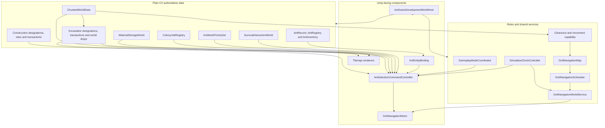
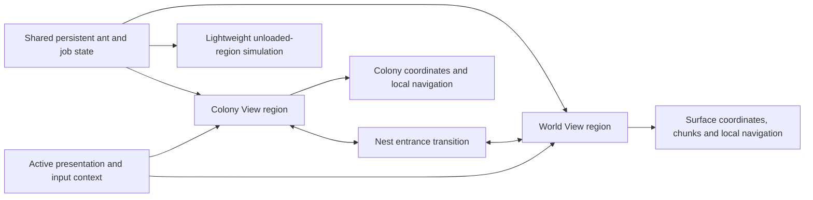

# Technical Architecture

## WV-B3C.2B transaction coordinator — complete

WV-B3C.2B implements one scenario-local coordination
registry over existing physical owners. Its parent transfer ID is separate from
`GroundStackId`, `ColonyJobId`, `AntId` and producer operation keys. It records
one immutable single-destination payload plus individually identified source
pickup operations and a `Prepared → Reserved → PickedUp → Delivered → Completed` outcome,
but never stores a second physical quantity: ground, inventory, Storage or
Construction staging remains authoritative for each committed phase.

The shared scheduler, navigation, priorities and Construction-first destination
ordering remain unchanged. Planning is bounded to 24 evaluated sources and
eight pickups with deterministic route-cost ties and a detour guard. Exclusive source/destination reservations are
transfer-owned, carrier inventory gains an in-flight allocation, and terminal
ground and Storage sources may feed the same carrier allocation, while Storage
withdrawal is restricted to Construction staging. This is planning
coordination only; no physical quantity authority moved. Scenario replacement
invalidates the old registry and replay cannot run either physical commit twice.
After the first partial pass exposed recovery defects, the corrected implementation
received user-confirmed **30/30** authoritative manual Unity acceptance. See the
[`Partial Hauling Integration Plan`](https://github.com/Stevr0/AntGame/blob/main/Documentation/PartialHaulingIntegrationPlan.md).

## WV-B3C.2A canonical ground-stack authority

`WorldMaterialDropRegistry` is still the only mutable owner of supported loose
ground resources. Its internal indices now enforce one canonical stack per
Colony cell and one resource type per stack. `GroundStackId` is allocated from a
fresh scenario context and local sequence, while producer operation keys remain
separate replay guards. Registry records own quantity, the provisional
resource-defined capacity, exclusive reservation, revision, provenance and
lifecycle; callers receive immutable snapshots.

Runtime registry instances validate against `ChunkedWorldData`. Extraction may
preflight the exact obstructing source Solid it will remove; ordinary drops may
not occupy missing cells, Solids/Nodes or completed functional Backgrounds, and
unknown compatibility fails closed. The existing explicit inventory-drop
command retains a narrow validated-current-anchor compatibility path on legacy
functional Backgrounds until Placement migration; other producers cannot use
that exception. The Colony runtime-cell adapter is a read-only authoritative
projection and cell-change bridge, not another store.
Inventory, Construction staging and Material Storage retain separate quantity
and capacity ownership. Scenario rebuild constructs a fresh registry/context;
whole-world construction is still not transactional under `WV-B3B-LIM-001`.

## Resource and Node System v1.0 target

The approved target gives every Solid a finite variable-quantity Resource Node,
uses whole-node Extraction, and commits complete recoverable physical output.
Resource Definitions own material metadata; Node instances own actual quantity;
canonical Stack records own loose quantity. Overflow reserves deterministic
additional cells or remains a recoverable pending transaction. Natural
Backgrounds own no colony function, and finite Water requires a
liquid-compatible representation. See [Resource and Node System](resource-and-node-system.md).

WV-B3C.3A now implements the Colony portion of this ownership: the established
registry owns generated Soil/Stone quantity, while terrain retains guarded Solid
occupancy. Canonical loose stacks and Hauling transfers are also active. The
whole-node output coordinator, Surface resources and functional-Background
migration remain later B3C.3B/WV-B3D gates.

WV-B3C.3A is complete after green focused/full Unity suites and **25/25**
user-confirmed manual checks. This acceptance closes the active Node authority
slice only; it does not add the whole-node output coordinator or expand atomic
publication beyond the Colony/Surface read-model pair under `WV-B3B-LIM-001`.

The target Placement boundary is specified in
[`Documentation/ConstructionPlacementSpecification.md`](https://github.com/Stevr0/AntGame/blob/main/Documentation/ConstructionPlacementSpecification.md).
Construction Sites own footprint reservation, staging and progress but expose no
completed function. Exact-once completion consumes staging and creates a
Placement instance over retained natural Backgrounds. Completed Placements own
their capacity, contents and functional reservations. Legacy
`SurvivalInteractionWorld`/`MaterialStorageWorld` state must be copied and
validated before a cell-level cutover disables its functional Background.

## Colony Resource Node registry

WV-B3C.1 introduced the scenario-local registry seam; WV-B3C.3A activates it as
sole mutable Soil/Stone quantity authority. Scenario construction scans resident
Colony terrain once and creates one record per registered Soil/Stone Solid.
Generated records retain configuration/version/seed provenance and use Soil
8–12 or Stone 5–15; fixture records use a versioned fixture namespace and
quantity one. Reads expose immutable snapshots.

The registry owns quantity; `ChunkedWorldData` owns terrain/Solid occupancy and
Background. Its mutation guard rejects bypass writes, while narrow one-use
tokens support fixture debug operations and safe quantity-one Extraction.
Committed registry mutations publish one Node change through the unified Colony
adapter. Variable-node legacy Extraction remains deferred and unowned. Scenario
replacement invalidates the old handle after the replacement setup succeeds;
camera switching does not rebuild it. This does not expand WV-B3B read-model
atomicity into whole-world atomicity.

## WV-B3B runtime-cell read foundation

`AntGameDevelopmentWorldHost` publishes one validated
`RuntimeCellRegionSet`. `ColonyRuntimeCellRegionAdapter` reads the existing
terrain/drop authorities; `SurfaceRuntimeCellRegionAdapter` reads the existing
bounded Surface and generated provenance. `TwoViewWorldCoordinator` consumes
the same Surface instance. Immutable snapshots carry cell and publication
revisions, and bounded caller-cursor journals report only committed terrain/drop
changes. The compatibility validator is pure diagnostics/future integration;
no gameplay writer was moved and current actions are not newly rejected.

Publication swaps both read adapters or neither. Broader host rebuild rollback
remains the existing scenario restore behavior, not a general world transaction.
Generated nodes are generation-only. WV-B3C/B3D and WV-C1 remain deferred.

## WV-B3A authoritative runtime-cell target

WV-B3A approves one region-scoped cell contract while leaving the runtime
unchanged. `ChunkedWorldData` remains the Colony backing authority; a future
Surface store will implement the same narrow read/mutation contract. Generated
snapshots initialise but do not remain mutable authorities. Navigation,
Tilemaps, colliders, Surface visuals, HUD and inspectors are projections.

Central compatibility and transaction validation will enforce one Background,
optional Node/Placement/loose stack and single physical ownership. Typed region
coordinates, both local navigators, cameras, entrance/residency and the shared
clock remain separate. See [Unified Runtime Cells](unified-runtime-cells.md).

## WV-B2B-ARCH-001 resource ownership flow

`ExcavationWorldTransaction` is the compatibility-named Extraction commit seam:
it removes a Soil/Stone node only after a recoverable loose output is prepared.
`MaterialHaulingOrder` is the sole normal transport executor and reserves both a
loose source and an explicit `ConstructionSite` or `MaterialStorage` destination.
`ConstructionSite` owns per-resource requirements, incoming reservations and
staged quantities. `ConstructionJobOrder` accepts only fully supplied sites and
performs work; it no longer calls inventory, Storage-withdrawal or loose-pickup
paths. All three use the existing shared job registry and navigation—there is no
second Extraction or Hauling scheduler.

The legacy `Excavation*`, `BindExcavation`, `TryDesignateExcavation` and
`WorldDesignationMode.Excavate` names remain compatibility/API seams. The
authoritative enum/catalog entries and player-facing labels are Extraction.

## WV-B2B generated-data flow — 15 October 2026

`ProceduralWorldGenerator` owns only initial immutable records and validation.
After a successful gate, `GeneratedWorldSnapshot.CreateColonyWorld` projects
natural Background/node occupancy into `ChunkedWorldData`, while
`CreateSurfaceNavigationWorld` projects Water and obstructing nodes into the
bounded Surface obstacle authority. `AntGameDevelopmentWorldHost` owns scenario
selection/publication; `TwoViewWorldCoordinator` consumes validated endpoints
and builds temporary region-isolated visuals. Cameras never call the generator.

The generator records placement and loose-stack slots but starts them empty.
It does not replace construction, storage, drops, excavation transactions,
navigation, ant records, residency or the simulation clock.

Generation version 2 reserves a deterministic Stone node at `(-4,-8)` on the
founding chamber boundary. It is projected through the same
`GeneratedWorldSnapshot.CreateColonyWorld` adapter and registered Solid
definition as every other generated Stone node; no special excavation executor
exists. Autonomous work retains the shared `ColonyJobSelectionService`.
Construction contributes only a read-only material-dependency eligibility check
before selection; `ColonyJobRegistry` records the unmet dependency as an unowned
paused job, and the existing selector naturally reconsiders it on later passes.
Dynamic Hauling uses the same eligibility boundary: it validates source access,
ant carrying capacity and a reachable compatible Storage destination without
reserving anything. A destination-less plan remains a registry-owned paused
opportunity, so its source stays available until staging or Storage capacity
makes Hauling executable.

## Approved unified cell boundary — 15 October 2026

**Implemented for generated records; legacy runtime migration deferred.** Surface and Colony share one logical cell
shape: exactly one natural Background plus optional Solid/Resource Node,
Construction/Placement and one-type loose resource stack. This is an ownership
contract, not a four-Tilemap mandate. Region-specific adapters retain typed
coordinates, separate A*, movement, clearance and rendering.

WV-B2B provides generated Background/node records and leaves placement/loose
slots empty. Existing Colony Background/Solid data adapts into the model;
quantity-less legacy Solids appear as deterministic quantity-one nodes. Existing
functional Backgrounds project as legacy placements until a later authorised
migration. See [Procedural World Generation](procedural-world-generation.md).

## WV-B2A generation boundary — 15 October 2026

The future generator is a pure initial-data producer, not a new runtime owner.
It derives independent named Surface/Colony streams from one versioned world
seed, builds temporary region/source/feature records, validates the complete
cross-region result and only then publishes it. `ChunkedWorldData` plus existing
material, navigation and excavation services remain Colony authorities;
`SurfaceWorldData`/`SurfacePathfinder` remain separate Surface authorities.
`AntRegistry`, residency, the clock, HUD, cameras and rendering are consumers,
never generator dependencies. See [Procedural World
Generation](procedural-world-generation.md).

The current development `SampleWorldGenerator` remains a fixture builder and is
not the production generator. An explicit scenario/provider selection will keep
Mara/Pip/Tala separate from the one-queen generated scenario. View switching and
presentation rebuilds may not invoke generation or reset mutable world state.

The strongest reusable transaction seams are prepare-before-commit excavation,
physical inventory/storage transfers and reservations. The
current loose-drop registry's multiple same-cell stacks and construction's
Background replacement are compatibility mismatches, not target architecture.

## WV-B1 implemented two-view boundary — 14 October 2026

WV-B1 implements the typed and transactional subset of WV-A. `AntColony.World` owns region/cell value types plus bounded Surface data/A*; `AntColony.Navigation` owns the clock-driven kinematic Surface motor; `AntColony.Commands` owns exactly-one residency and the capacity-one entrance transaction; `AntColony.Development` composes both loaded regions, two cameras and explicit input contexts. `AntRecord`, `AntRegistry`, `AntEntityBinding`, the Colony world/navigation stack and `SimulationClockController` remain the existing authorities.

The development adapter keeps the same bound GameObject across regions and switches local motors after residency commit. This is intentionally reversible and prevents a second live binding; it does not make the visual authoritative. Surface activation failure restores source residency and pose. No second clock, generic coordinate conversion, cross-region A*, resource authority or streaming system was introduced.

## WV-A approved inputs (documentation baseline) — 14 October 2026

This historical WV-A decision specified but did not itself implement one paired,
pre-authored bidirectional entrance with capacity one ant; manual Colony/World
presentation switching; physical approach and atomic residency/representation
handoff; one shared clock; finite nearby sources; provisional liquid carriage;
and natural rest. WV-B1 has since implemented the typed region, view, local
movement and entrance subset. Natural sources, liquid and rest remain deferred.

WV-A is now specified in [World View Foundation](world-view-foundation.md). The authoritative detailed contract is `Documentation/WorldViewTechnicalSpecification.md`; this wiki page is its concise implementation companion.

## Project shape

- Unity `6000.3.8f1`
- 2D Universal Render Pipeline
- New Input System
- C# runtime code under `Assets/AntColony/Scripts/`
- Edit Mode and Play Mode tests under `Assets/AntColony/Tests/`
- Authored scenes and prefabs under `Assets/AntColony/`
- No networking package; the game is single-player

The project preserves an authored-content-first approach. Scene and prefab references remain explicit, while plain-C# models own game state where Unity components are unnecessary.

## Runtime ownership

### Ant data

`AntColony.Ants` owns stable identity, colony membership, caste, attributes, lifecycle, skills, needs, per-ant work priorities and stack-based personal inventory. Runtime visuals bind to records rather than becoming the source of truth.

### World data

`AntColony.World` owns chunks, Background/Solid material definitions, loose material drops, physical Material Storage slots, the atomic excavation commit, classification, clearance, capability, pathfinding data, and scheduling. Visual and collision Tilemaps project that data through `AntColony.WorldPresentation`; they do not own stored quantities.

Milestone 3.5B narrows the atomic Extraction boundary to terrain plus loose output. It validates the Solid and preflights the definition yield in `WorldMaterialDropRegistry` before removing foreground, then commits the prepared same-cell result under the stable job key. `AntInventory` is not an Extraction destination. WV-B2B-ARCH-001 routes later pickup and delivery through destination-aware Hauling; Construction no longer self-supplies.

### Art assets and presentation boundary

Custom art is organised under `Assets/_AntGame/Art/Colony` and `Assets/_AntGame/Art/World`, with preserved originals separated from prepared candidate sprites. `Tools/Art/prepare_tilesets.py` records measured extraction rectangles and generates deterministic 32-pixel libraries; the resulting sprite names describe source position only.

Candidate sprites do not own or imply material identity. Colony art must be separated into Background, optional foreground Solid, exposed-edge and decoration responsibilities before binding to the existing Tilemap projection. Collision stays on the dedicated collision Tilemap. World art remains an unbound future-view library until its terrain and coordinate authority are approved.

Milestone 3.5A binds only reviewed `Colony_R02_C01` for Soil, `Colony_R05_C05` for Stone Solid and `Colony_R05_C03` for Natural Stone Background. Darker Tile colours distinguish natural Background projections. Tile colliders remain `None`; the dedicated collision Tilemap continues to read only authoritative Solid definitions.

### Navigation

One `GridNavigationWorldService` owns the shared navigation map and bounded scheduler for a world. Each `GridNavigationMotor` owns only its agent request and execution state. Command and interaction systems call the narrow motor API.

### Commands and interactions

`AntColony.Commands` handles selection, designation input, context orders, visual bindings, physical survival, synthetic work, real excavation, explicit material pickup/drop, autonomous hauling and real Background construction. Location-owned supplies remain in `SurvivalInteractionWorld`; job identity, ownership and progress remain in `ColonyJobRegistry`; designation registries are typed views over those same jobs rather than second queues. Source reservations remain in the world-drop or Material Storage authority, and carried stacks remain on the ant record. All travel reuses the shared map and motor.

`ColonyJobSelectionService` performs bounded fair choice without owning jobs. The
registry exposes stable creation order plus a collection revision; each ant's
selector pass advances through at most 32 entries per evaluation and retains one
best reachable candidate per work priority until the complete pass finishes.
Append-only additions join the pass; removal or priority revisions restart it,
while status changes are revalidated before assignment. The command controller treats an unfinished page
as normal scheduled progress, not a work failure. Reservations, pause gating and
1×/2×/3× timing remain in their existing authorities.

`ConstructionJobOrder` reserves one builder and moves existing physical material through inventory into a cell-owned `ConstructionSite`. `ConstructionWorldTransaction` validates occupancy, source Background and staged quantity before consuming once, replacing only the Background, registering one functional-capacity slot, refreshing presentation and invalidating navigation.

When construction needs inventory capacity, `InventoryCapacityRecoveryOperation` is a reusable task-executor helper rather than a new hauling job. It protects the current task's resource type, uses existing path measurement and incoming storage reservations, commits deposits only after travel, or invokes the existing conserving drop transaction at a valid anchor. Cancellation releases uncommitted capacity reservations while leaving every physical quantity at its current owner. Loose drops remain ordinary traversable world data; future clutter penalties do not yet participate in navigation or room-quality calculation.

### Development composition

`AntGameDevelopmentWorldHost` assembles the deterministic integrated test world. It is a focused authored coordinator, not a global production manager. Developer controls and diagnostics expose authoritative state for acceptance checks.

`SimulationClockController` is the scene-owned runtime time authority. It starts at Day 1 08:00 paused, exposes read-only elapsed seconds/hours/day-time, and supplies bounded simulation deltas at 1×/2×/3×. Unity `Time.timeScale` stops fixed-step physics; the original `timeScale`, `fixedDeltaTime` and `maximumDeltaTime` are captured and restored. Fixed and maximum deltas stay at their project baselines, so faster speeds produce more fixed steps per real second rather than changing the physics step size. Each unscaled frame contribution is capped by `maximumDeltaTime` to avoid unbounded catch-up.

`GameplayModeCoordinator` owns only normal-gameplay policy: survival, colony work and hauling follow one enabled bundle unless Developer Mode forces a subsystem on or off. It never owns orders and never changes clock state. `GridNavigationWorldService` and the command controller use explicit clock references to stop scheduler and gameplay progress while paused. Camera movement remains intentionally unscaled.

Milestone 3.4C adds `AntColony.PlayerUI` as a presentation-only assembly. The authored `PlayerHud.prefab` contains focused roster, selected-ant inspector, simulation-control, Colony View command, physical-resource and job-status presenters. `AntGameDevelopmentWorldHost` binds them to the existing `AntRegistry`, command/designation registries, physical storage/drop/site owners and the single `SimulationClockController`; the HUD creates none of those authorities. Shared identity, needs, skills, inventory and job information is displayed independently from the inspector's separate Colony View position/navigation section.

The roster reads authoritative records and uses a narrow compatibility adapter to select a currently loaded `SelectableGridAnt`. It never defines identity from the GameObject and performs no repeated scene-wide discovery. This leaves future unloaded or World View records representable without inventing residency state now. The resource summary performs a bounded unscaled refresh and reports stored, carried, loose and staged ownership separately; reservations are not counted again because ownership does not change until commit.

`AntSelectionCommandController` retains accepted command and developer-IMGUI behavior, but no longer acts as the player HUD. It starts Developer Mode hidden and opens through F12 or the separate centre-top reopen control. `DevelopmentWorldInspector` still owns World/Debug developer panels and all seven categories remain available. The controller accepts only an `IPlayerUiInputBlocker` read-only hit test; the uGUI implementation uses the one EventSystem and `GraphicRaycaster`, while existing IMGUI rectangles protect developer controls. Selection, context orders, designation drag start/release and camera mouse input all consult the combined boundary. The temporary `SimulationTimeControlStrip` is no longer authored in the development scene.

The command toolbar declares only `PlayerViewContext.Colony`. Its Select, Extract, Background conversion and cancellation actions delegate to accepted APIs. Area cancellation invokes construction and compatibility-named excavation registries, so staged construction material follows the recoverable-drop transaction.

Milestone 3.5A keeps preview state presentation-only inside `AntSelectionCommandController`. Each hovered or bounded drag cell is classified by the same excavation/construction registry validation used by commit. IMGUI draws the bounded overlay without per-cell GameObjects. Active-tool right-click is consumed before contextual orders and delegates to only the compatible registry cancellation API.

Milestone 3.4D adds a global `ColonyManagementView` and reusable authored work-priority row. The view enumerates active `AntRecord` entries and writes their existing `AntWorkPrioritySet` through a narrow command API that also schedules the next ordinary work evaluation. It does not select the ant, require a loaded visual, cancel active work or own job-choice logic. Rows may consult a loaded `SelectableGridAnt` only for current activity text. The player matrix exposes Extraction, Construction and Hauling because those categories have real executors; developer diagnostics retain the full catalog over the same underlying values.

The management overlay remains inside the existing Canvas and EventSystem. Its full-screen raycast target protects priority clicks and scrolling from world/camera input. An optional keyboard-focus boundary consumes Escape for the modal before Colony View designation cancellation, without coupling command logic to uGUI types. Opening the overlay never owns or changes simulation-clock state.

## Approved two-view target architecture

> **Design boundary — not implemented.** The responsibilities below describe constraints for future milestones. They deliberately avoid committing to final component or class names. Current runtime ownership above remains the implemented architecture.

### Responsibility boundaries

| Concern | Proposed responsibility | Required invariant |
| --- | --- | --- |
| View management | Select the presented region, camera and input context | Switching views does not pause, clone or reinitialise the simulation |
| Shared ant state | Own identity, stats, skills, needs, inventory, lifecycle and job state independently of a view | One authoritative ant record exists across all regions |
| Region residency | Record which region/chunk currently contains an ant and whether it has a loaded visual representation | An ant cannot be resident in two regions or own two live representations simultaneously |
| Coordinate spaces | Keep Colony View cells, World View surface coordinates and entrance mappings explicit | Coordinates from one view are never interpreted implicitly as coordinates in the other |
| World chunks | Own bounded surface data, loading, persistence and generation separately from Colony View's underground tile semantics | Missing/unloaded chunks are unavailable, not assumed empty or generated by read-only queries |
| Local navigation | Let each view use navigation appropriate to its geometry and movement rules | Colony gripping/falling remains intact; World View does not require the same local graph |
| Cross-view navigation | Compose local travel, an entrance transition and destination-region travel | Cross-view jobs use one ant/order identity and expose recoverable transition failure states |
| Transition boundary | Validate source entrance, destination entrance, residency and representation handoff as one controlled operation | Departure and arrival cannot duplicate or lose the ant or its inventory |
| Simulation persistence | Advance both views from the shared simulation clock whether or not they are presented | View switching cannot freeze the hidden region or grant extra elapsed time |
| Unloaded simulation | Eventually advance important state with bounded reduced fidelity and reconcile it on reload | No claim of full Rigidbody or frame-by-frame navigation outside loaded chunks |

### Coordinate and chunk policy

Colony View retains its implemented signed cell/chunk coordinates and permanent Background plus optional Solid model. World View requires its own approved surface coordinate and terrain specification. A shared chunk size or data schema is not assumed merely because both regions are chunked. Cross-view references use stable region and entrance identities plus explicit local positions rather than one ambiguous global `Vector2`.

WV-A requires distinct `ColonyCell` and `SurfaceCell` value types wrapped by
region-scoped location variants. The existing integer-centre Colony mapping is
unchanged. WV-B1 approved and implemented a `64×64` logical Surface with a
`32×32` future partition seam, one-unit cells and fixed obstacle/no-corner-cut
rules. It still does not reuse `ChunkedWorldData` by assumption. WV-B2A specifies
how a future generated Surface preserves that separation.

The first World View implementation should load one small bounded surface region around a known entrance. Continuous-world streaming, additional environments and distant chunks follow only after the bounded transition and return loop is validated.

### Navigation and transitions

A cross-view route is conceptually three parts: a local route to a nest entrance, a validated region transition, and a local route from the paired entrance. The local navigation implementations may differ, but job selection and order execution need a common way to report reachability, progress, cancellation and failure. Reservations associated with an ant or physical item must remain stable through the handoff or be released by explicit existing cancellation semantics.

The transition reserves the capacity-one entrance, completes the source local approach, revalidates both endpoints, acquires an idempotent commit guard, changes one residency revision and then performs a single representation handoff. Destination activation failure rolls residency back to the source; source ownership remains authoritative even if its visual must be restored later. Shared identity, needs, skills, jobs and inventory are never copied. Exact animation and timing remain WV-B approvals.

### Simulation and persistence boundary

- Both initial regions remain loaded and advance full simulation from the one `SimulationClockController`, including when hidden.
- Pause freezes both regions, transition commits, route scheduling, needs, jobs, interactions and retry time. View switching never changes clock state.
- Region residency is persistent authoritative state keyed by `AntId`; representation and camera state do not define it.
- Save/version structure, durable Surface mutations and in-progress route persistence remain unapproved.
- Reduced-fidelity unloaded simulation and reconciliation are explicitly deferred to WV-F; WV-B and WV-C must not simulate unloaded chunks.

## Scene flow

| Scene | Purpose | Status |
| --- | --- | --- |
| `AntMovementPrototype.unity` | Continuous-input surface movement regression course | Retained developer fixture |
| `AntNavigationPrototype.unity` | Navigation classification and visualisation fixture | Retained developer fixture |
| `AntGameDevelopment.unity` | Integrated world, ants, selection, movement, survival, jobs, excavation, inventory, storage, hauling and Background construction | Primary development scene |

There is no finished menu-to-game flow, Bootstrap scene, save selection, or production world-loading sequence yet. Future work must preserve the existing authored coordinator seams rather than introducing an unnecessary global manager.

No World View scene, surface region, view manager or transition runtime exists yet. Whether the two views ultimately use separate scenes, additive scenes or another authored composition is intentionally unresolved; future implementation must satisfy the ownership invariants above before choosing that packaging.

## Test strategy

- Plain-C# Edit Mode tests cover deterministic records, world rules, pathfinding, scheduling, and interactions.
- Physics-backed tests cover collider projection, movement, falling, and integration behavior.
- Play Mode tests cover scene wiring and end-to-end interaction slices.
- Structural validators inspect authored scenes and prefabs.
- Manual checklists cover visuals, input, timing, diagnostics, and behaviors that automation does not observe.
- Focused development-UI tests cover exclusive category state, collapse/hide behavior, resolution bounds and shared pointer blocking before the complete regressions run.

Compilation, automated tests, and manual acceptance are recorded separately. A successful build never implies Unity Play Mode acceptance.

## Architectural guardrails

- Keep input/commands, task choice, navigation, motor execution, physics, and presentation separate.
- Preserve Unity `.meta` files and serialized references.
- Use Unity-aware null checks (`component == null`) for destroyed objects.
- Prefer local invalidation and shared maps over per-ant world duplication.
- Add major dependencies only after an identified need and explicit approval.

See the [Documentation Workflow](documentation-workflow.md) for keeping this page synchronized.
