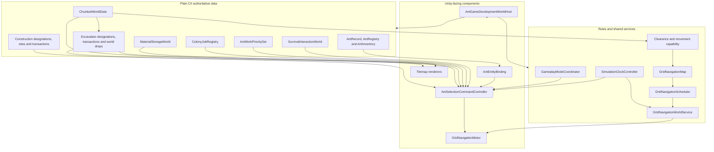
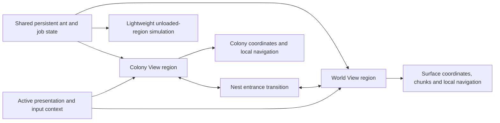

# Technical Architecture

## Project shape

- Unity `6000.3.8f1`
- 2D Universal Render Pipeline
- New Input System
- C# runtime code under `Assets/AntColony/Scripts/`
- Edit Mode and Play Mode tests under `Assets/AntColony/Tests/`
- Authored scenes and prefabs under `Assets/AntColony/`
- No networking package; the game is single-player

The project preserves an authored-content-first approach. Scene and prefab references remain explicit, while plain-C# models own game state where Unity components are unnecessary.

## Runtime ownership

### Ant data

`AntColony.Ants` owns stable identity, colony membership, caste, attributes, lifecycle, skills, needs, per-ant work priorities and stack-based personal inventory. Runtime visuals bind to records rather than becoming the source of truth.

### World data

`AntColony.World` owns chunks, Background/Solid material definitions, loose material drops, physical Material Storage slots, the atomic excavation commit, classification, clearance, capability, pathfinding data, and scheduling. Visual and collision Tilemaps project that data through `AntColony.WorldPresentation`; they do not own stored quantities.

### Art assets and presentation boundary

Custom art is organised under `Assets/_AntGame/Art/Colony` and `Assets/_AntGame/Art/World`, with preserved originals separated from prepared candidate sprites. `Tools/Art/prepare_tilesets.py` records measured extraction rectangles and generates deterministic 32-pixel libraries; the resulting sprite names describe source position only.

Candidate sprites do not own or imply material identity. Colony art must be separated into Background, optional foreground Solid, exposed-edge and decoration responsibilities before binding to the existing Tilemap projection. Collision stays on the dedicated collision Tilemap. World art remains an unbound future-view library until its terrain and coordinate authority are approved.

Milestone 3.5A binds only reviewed full-cell `Colony_R02_C01` and `Colony_R04_C01` sprites through the existing Soil/Stone visual Tile assets. Darker Tile colours distinguish the corresponding natural Background projections. Tile colliders remain `None`; the dedicated collision Tilemap continues to read only authoritative Solid definitions.

### Navigation

One `GridNavigationWorldService` owns the shared navigation map and bounded scheduler for a world. Each `GridNavigationMotor` owns only its agent request and execution state. Command and interaction systems call the narrow motor API.

### Commands and interactions

`AntColony.Commands` handles selection, designation input, context orders, visual bindings, physical survival, synthetic work, real excavation, explicit material pickup/drop, autonomous hauling and real Background construction. Location-owned supplies remain in `SurvivalInteractionWorld`; job identity, ownership and progress remain in `ColonyJobRegistry`; designation registries are typed views over those same jobs rather than second queues. Source reservations remain in the world-drop or Material Storage authority, and carried stacks remain on the ant record. All travel reuses the shared map and motor.

`ConstructionJobOrder` reserves one builder and moves existing physical material through inventory into a cell-owned `ConstructionSite`. `ConstructionWorldTransaction` validates occupancy, source Background and staged quantity before consuming once, replacing only the Background, registering one functional-capacity slot, refreshing presentation and invalidating navigation.

When construction needs inventory capacity, `InventoryCapacityRecoveryOperation` is a reusable task-executor helper rather than a new hauling job. It protects the current task's resource type, uses existing path measurement and incoming storage reservations, commits deposits only after travel, or invokes the existing conserving drop transaction at a valid anchor. Cancellation releases uncommitted capacity reservations while leaving every physical quantity at its current owner. Loose drops remain ordinary traversable world data; future clutter penalties do not yet participate in navigation or room-quality calculation.

### Development composition

`AntGameDevelopmentWorldHost` assembles the deterministic integrated test world. It is a focused authored coordinator, not a global production manager. Developer controls and diagnostics expose authoritative state for acceptance checks.

`SimulationClockController` is the scene-owned runtime time authority. It starts at Day 1 08:00 paused, exposes read-only elapsed seconds/hours/day-time, and supplies bounded simulation deltas at 1×/2×/3×. Unity `Time.timeScale` stops fixed-step physics; the original `timeScale`, `fixedDeltaTime` and `maximumDeltaTime` are captured and restored. Fixed and maximum deltas stay at their project baselines, so faster speeds produce more fixed steps per real second rather than changing the physics step size. Each unscaled frame contribution is capped by `maximumDeltaTime` to avoid unbounded catch-up.

`GameplayModeCoordinator` owns only normal-gameplay policy: survival, colony work and hauling follow one enabled bundle unless Developer Mode forces a subsystem on or off. It never owns orders and never changes clock state. `GridNavigationWorldService` and the command controller use explicit clock references to stop scheduler and gameplay progress while paused. Camera movement remains intentionally unscaled.

Milestone 3.4C adds `AntColony.PlayerUI` as a presentation-only assembly. The authored `PlayerHud.prefab` contains focused roster, selected-ant inspector, simulation-control, Colony View command, physical-resource and job-status presenters. `AntGameDevelopmentWorldHost` binds them to the existing `AntRegistry`, command/designation registries, physical storage/drop/site owners and the single `SimulationClockController`; the HUD creates none of those authorities. Shared identity, needs, skills, inventory and job information is displayed independently from the inspector's separate Colony View position/navigation section.

The roster reads authoritative records and uses a narrow compatibility adapter to select a currently loaded `SelectableGridAnt`. It never defines identity from the GameObject and performs no repeated scene-wide discovery. This leaves future unloaded or World View records representable without inventing residency state now. The resource summary performs a bounded unscaled refresh and reports stored, carried, loose and staged ownership separately; reservations are not counted again because ownership does not change until commit.

`AntSelectionCommandController` retains accepted command and developer-IMGUI behavior, but no longer acts as the player HUD. It starts Developer Mode hidden and opens through F12 or the separate centre-top reopen control. `DevelopmentWorldInspector` still owns World/Debug developer panels and all seven categories remain available. The controller accepts only an `IPlayerUiInputBlocker` read-only hit test; the uGUI implementation uses the one EventSystem and `GraphicRaycaster`, while existing IMGUI rectangles protect developer controls. Selection, context orders, designation drag start/release and camera mouse input all consult the combined boundary. The temporary `SimulationTimeControlStrip` is no longer authored in the development scene.

The command toolbar declares only `PlayerViewContext.Colony`. Its Select, Excavate, Background conversion and cancellation actions delegate to accepted APIs. Area cancellation invokes construction and excavation registries, so staged construction material follows the existing recoverable-drop transaction. No view manager, World View state, surface input or shared world-coordinate abstraction was added.

Milestone 3.5A keeps preview state presentation-only inside `AntSelectionCommandController`. Each hovered or bounded drag cell is classified by the same excavation/construction registry validation used by commit. IMGUI draws the bounded overlay without per-cell GameObjects. Active-tool right-click is consumed before contextual orders and delegates to only the compatible registry cancellation API.

Milestone 3.4D adds a global `ColonyManagementView` and reusable authored work-priority row. The view enumerates active `AntRecord` entries and writes their existing `AntWorkPrioritySet` through a narrow command API that also schedules the next ordinary work evaluation. It does not select the ant, require a loaded visual, cancel active work or own job-choice logic. Rows may consult a loaded `SelectableGridAnt` only for current activity text. The player matrix exposes only Excavation, Construction and Hauling because those categories have real executors; developer diagnostics retain the full catalog over the same underlying values.

The management overlay remains inside the existing Canvas and EventSystem. Its full-screen raycast target protects priority clicks and scrolling from world/camera input. An optional keyboard-focus boundary consumes Escape for the modal before Colony View designation cancellation, without coupling command logic to uGUI types. Opening the overlay never owns or changes simulation-clock state.

## Approved two-view target architecture

> **Design boundary — not implemented.** The responsibilities below describe constraints for future milestones. They deliberately avoid committing to final component or class names. Current runtime ownership above remains the implemented architecture.

### Responsibility boundaries

| Concern | Proposed responsibility | Required invariant |
| --- | --- | --- |
| View management | Select the presented region, camera and input context | Switching views does not pause, clone or reinitialise the simulation |
| Shared ant state | Own identity, stats, skills, needs, inventory, lifecycle and job state independently of a view | One authoritative ant record exists across all regions |
| Region residency | Record which region/chunk currently contains an ant and whether it has a loaded visual representation | An ant cannot be resident in two regions or own two live representations simultaneously |
| Coordinate spaces | Keep Colony View cells, World View surface coordinates and entrance mappings explicit | Coordinates from one view are never interpreted implicitly as coordinates in the other |
| World chunks | Own bounded surface data, loading, persistence and generation separately from Colony View's underground tile semantics | Missing/unloaded chunks are unavailable, not assumed empty or generated by read-only queries |
| Local navigation | Let each view use navigation appropriate to its geometry and movement rules | Colony gripping/falling remains intact; World View does not require the same local graph |
| Cross-view navigation | Compose local travel, an entrance transition and destination-region travel | Cross-view jobs use one ant/order identity and expose recoverable transition failure states |
| Transition boundary | Validate source entrance, destination entrance, residency and representation handoff as one controlled operation | Departure and arrival cannot duplicate or lose the ant or its inventory |
| Simulation persistence | Advance both views from the shared simulation clock whether or not they are presented | View switching cannot freeze the hidden region or grant extra elapsed time |
| Unloaded simulation | Eventually advance important state with bounded reduced fidelity and reconcile it on reload | No claim of full Rigidbody or frame-by-frame navigation outside loaded chunks |

### Coordinate and chunk policy

Colony View retains its implemented signed cell/chunk coordinates and permanent Background plus optional Solid model. World View requires its own approved surface coordinate and terrain specification. A shared chunk size or data schema is not assumed merely because both regions are chunked. Cross-view references use stable region and entrance identities plus explicit local positions rather than one ambiguous global `Vector2`.

The first World View implementation should load one small bounded surface region around a known entrance. Continuous-world streaming, additional environments and distant chunks follow only after the bounded transition and return loop is validated.

### Navigation and transitions

A cross-view route is conceptually three parts: a local route to a nest entrance, a validated region transition, and a local route from the paired entrance. The local navigation implementations may differ, but job selection and order execution need a common way to report reachability, progress, cancellation and failure. Reservations associated with an ant or physical item must remain stable through the handoff or be released by explicit existing cancellation semantics.

The transition must detach or suspend the source-region visual/motor before enabling the destination representation. Shared identity and inventory never transfer by copying; only residency and presentation change. Exact transition staging, animation and failure recovery remain unresolved design work.

### Simulation and persistence questions

- What minimum ant/job/need state advances in a loaded but hidden region?
- What lower-fidelity cadence is acceptable in an unloaded chunk, and how is catch-up bounded?
- Which activities require a loaded detailed simulation rather than abstract progress?
- How are entrance blockage, chunk unload and route invalidation represented to jobs?
- What save/version data identifies region residency and an in-progress transition?
- How are surface generation seeds and durable mutations stored without forcing all chunks resident?

## Scene flow

| Scene | Purpose | Status |
| --- | --- | --- |
| `AntMovementPrototype.unity` | Continuous-input surface movement regression course | Retained developer fixture |
| `AntNavigationPrototype.unity` | Navigation classification and visualisation fixture | Retained developer fixture |
| `AntGameDevelopment.unity` | Integrated world, ants, selection, movement, survival, jobs, excavation, inventory, storage, hauling and Background construction | Primary development scene |

There is no finished menu-to-game flow, Bootstrap scene, save selection, or production world-loading sequence yet. Future work must preserve the existing authored coordinator seams rather than introducing an unnecessary global manager.

No World View scene, surface region, view manager or transition runtime exists yet. Whether the two views ultimately use separate scenes, additive scenes or another authored composition is intentionally unresolved; future implementation must satisfy the ownership invariants above before choosing that packaging.

## Test strategy

- Plain-C# Edit Mode tests cover deterministic records, world rules, pathfinding, scheduling, and interactions.
- Physics-backed tests cover collider projection, movement, falling, and integration behavior.
- Play Mode tests cover scene wiring and end-to-end interaction slices.
- Structural validators inspect authored scenes and prefabs.
- Manual checklists cover visuals, input, timing, diagnostics, and behaviors that automation does not observe.
- Focused development-UI tests cover exclusive category state, collapse/hide behavior, resolution bounds and shared pointer blocking before the complete regressions run.

Compilation, automated tests, and manual acceptance are recorded separately. A successful build never implies Unity Play Mode acceptance.

## Architectural guardrails

- Keep input/commands, task choice, navigation, motor execution, physics, and presentation separate.
- Preserve Unity `.meta` files and serialized references.
- Use Unity-aware null checks (`component == null`) for destroyed objects.
- Prefer local invalidation and shared maps over per-ant world duplication.
- Add major dependencies only after an identified need and explicit approval.

See the [Documentation Workflow](documentation-workflow.md) for keeping this page synchronized.
