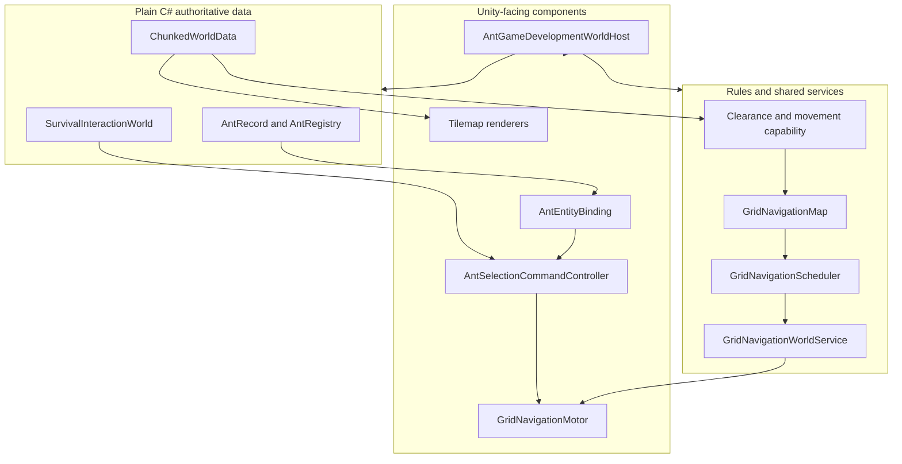

# Technical Architecture

## Project shape

- Unity `6000.3.8f1`
- 2D Universal Render Pipeline
- New Input System
- C# runtime code under `Assets/AntColony/Scripts/`
- Edit Mode and Play Mode tests under `Assets/AntColony/Tests/`
- Authored scenes and prefabs under `Assets/AntColony/`
- No networking package; the game is single-player

The project preserves an authored-content-first approach. Scene and prefab references remain explicit, while plain-C# models own game state where Unity components are unnecessary.

## Runtime ownership

### Ant data

`AntColony.Ants` owns stable identity, colony membership, caste, attributes, lifecycle, skills, and needs. Runtime visuals bind to records rather than becoming the source of truth.

### World data

`AntColony.World` owns chunks, Background/Solid material definitions, classification, clearance, capability, pathfinding data, and scheduling. Visual and collision Tilemaps project that data through `AntColony.WorldPresentation`.

### Navigation

One `GridNavigationWorldService` owns the shared navigation map and bounded scheduler for a world. Each `GridNavigationMotor` owns only its agent request and execution state. Command and interaction systems call the narrow motor API.

### Commands and interactions

`AntColony.Commands` handles selection, context orders, visual bindings, and the narrow physical-survival interaction slice. Location-owned storage and reservations live in the plain-C# `SurvivalInteractionWorld`, not in UI labels or Tilemap visuals.

### Development composition

`AntGameDevelopmentWorldHost` assembles the deterministic integrated test world. It is a focused authored coordinator, not a global production manager. Developer controls and diagnostics expose authoritative state for acceptance checks.

## Scene flow

| Scene | Purpose | Status |
| --- | --- | --- |
| `AntMovementPrototype.unity` | Continuous-input surface movement regression course | Retained developer fixture |
| `AntNavigationPrototype.unity` | Navigation classification and visualisation fixture | Retained developer fixture |
| `AntGameDevelopment.unity` | Integrated world, ants, selection, grid movement, needs, and interactions | Primary development scene |

There is no finished menu-to-game flow, Bootstrap scene, save selection, or production world-loading sequence yet. Future work must preserve the existing authored coordinator seams rather than introducing an unnecessary global manager.

## Test strategy

- Plain-C# Edit Mode tests cover deterministic records, world rules, pathfinding, scheduling, and interactions.
- Physics-backed tests cover collider projection, movement, falling, and integration behavior.
- Play Mode tests cover scene wiring and end-to-end interaction slices.
- Structural validators inspect authored scenes and prefabs.
- Manual checklists cover visuals, input, timing, diagnostics, and behaviors that automation does not observe.

Compilation, automated tests, and manual acceptance are recorded separately. A successful build never implies Unity Play Mode acceptance.

## Architectural guardrails

- Keep input/commands, task choice, navigation, motor execution, physics, and presentation separate.
- Preserve Unity `.meta` files and serialized references.
- Use Unity-aware null checks (`component == null`) for destroyed objects.
- Prefer local invalidation and shared maps over per-ant world duplication.
- Add major dependencies only after an identified need and explicit approval.

See the [Documentation Workflow](documentation-workflow.md) for keeping this page synchronized.
