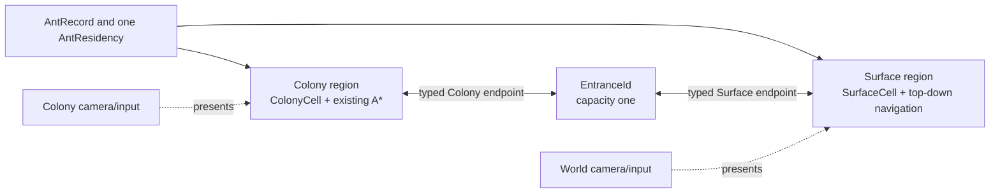
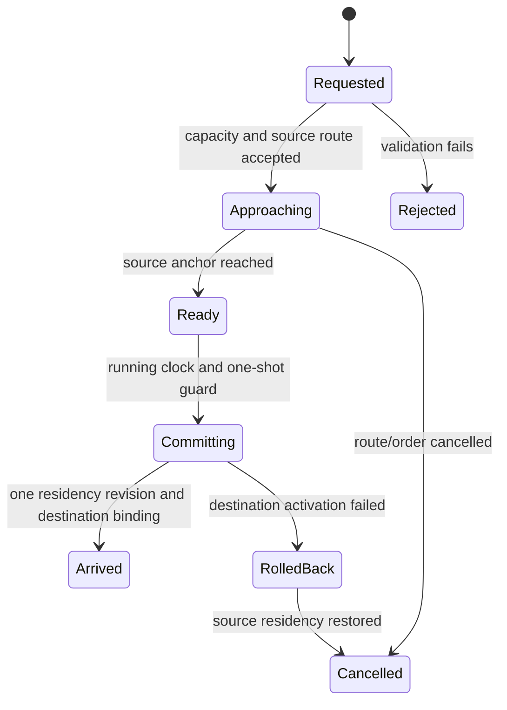
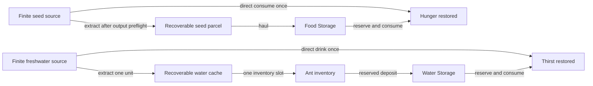

# World View Foundation

## Resource badge isolation

Quantity badges are region-specific world presentation. Colony loose stacks,
non-empty legacy Material Storage and designated quantity-one Colony Nodes draw
only while Colony presentation is enabled; switching to World View hides them
without changing resource quantity or revision. Generated Surface Nodes remain
`GenerationOnly` and are not labelled as interactable Extraction targets.
Future discovery/Fog-of-War policy must gate Surface quantities before they are
ever exposed.

## WV-B3A integration boundary

World View will share the runtime cell occupancy/mutation contract while keeping
`SurfaceCell`, Surface A*, motor, obstacles, presentation and camera distinct
from Colony systems. The entrance/residency transaction and shared clock are
unchanged. Fog of War and discovery will be knowledge projections and cannot
mutate physical cells. See [Unified Runtime Cells](unified-runtime-cells.md).

## WV-B2B generated scenario adapter

The development host now exposes an explicit generated founding-queen scenario
beside the unchanged Mara/Pip/Tala fixture. Validated scenario data supplies the
entrance endpoints; the existing capacity-one transaction, shared clock,
residency registry, local motors and camera culling remain authoritative. View
switching does not regenerate either region. Generated resource markers are not
yet resource interactions.

## Shared logical cell amendment

Surface and Colony now share required Background plus optional node, placement
and one-type loose-stack concepts. They do not share coordinates, A*, movement
or clearance implementations. The WV-B1 residency, capacity-one entrance and
rendering isolation remain unchanged. Generated records implement the unified
shape; the Surface navigator still consumes a narrow obstacle adapter.

## WV-B2A generated-world extension

The implemented generated-world contract is summarized in [Procedural World
Generation](procedural-world-generation.md). One seed produces both regions
without changing WV-B1 typed locations or entrance semantics. The Surface remains
`64×64` and predominantly Grass. The Colony is entirely underground,
predominantly solid Soil/Dirt and begins with one small chamber containing the
founding queen beneath the top-boundary exit. The Mara/Pip/Tala fixture remains
intact as the default separate scenario.

## Status

**WV-B1 implemented; validation remains incomplete.** Focused Edit/Play and complete Play suites pass, while complete graphics-capable Edit regression and manual acceptance remain outstanding. The authoritative detailed contract is `Documentation/WorldViewTechnicalSpecification.md`. Runtime now covers typed regions/residency, one bounded Surface, manual cameras, Surface-local movement and one entrance. Natural resources, rest, extraction, autonomous cross-view routing, streaming and unloaded simulation remain deferred.

The accepted foundation is one bounded top-down Surface region, one pre-authored bidirectional entrance with capacity one, manual remembered Colony/World cameras, physical ant approach travel, finite nearby seed/freshwater, one-unit recoverable liquid carriage and safe natural rest. Both starting regions remain loaded on the one simulation clock.

## Existing integration seams

- `AntRecord` and `AntRegistry` remain the single source for identity, needs, skills, inventory and lifecycle.
- `AntEntityBindingRegistry` already prevents duplicate live visuals and is the core representation-handoff guard.
- `SimulationClockController` remains the only clock; `GameplayModeCoordinator` stays independent from view choice.
- Existing grid navigation remains the Colony-local implementation. World View receives its own top-down coordinate and navigator.
- Current job/resource systems provide stable identity, reservation, exact-once commit and cancellation patterns, but their unscoped `Vector2Int` locations are Colony-only.
- `PlayerHudController` is presentation-only and can gain a narrow view selector without owning simulation.
- `AntGameDevelopmentWorldHost` and Mara/Pip/Tala remain untouched regression content.

WV-B1 adds `AntRegionResidencyRegistry`, `SurfaceWorldData`, `SurfacePathfinder`, `SurfaceNavigationMotor`, `NestEntranceTransitionService` and `TwoViewWorldCoordinator`. It still has no natural source, liquid payload, cross-view route planner or unloaded-region model.

## Implemented WV-B1 fixture and controls

- Surface bounds are `64×64` logical cells from `(0,0)` through `(63,63)` with a future-only `32×32` partition size.
- Fixed obstacle rectangles provide alternate deterministic routes. Diagonals require both adjacent cardinal cells to be traversable.
- **Colony View** and **World View** select one camera/input context while both regions remain loaded. Each camera object retains its own position and zoom.
- In World View, left-click selects a Surface-resident ant and right-click orders a valid Surface cell. Colony designation tools are hidden and their pointer conversion is disabled.
- **Use Nest Entrance** reserves `entrance.founding-nest.001` for the selected ant. Each local motor reaches its typed approach before residency can commit.
- The implementation preserves one existing bound GameObject and switches its active local motor during handoff. Residency and binding identity remain authoritative; activation failure rolls back to the source.

Focused Unity verification passed 8/8 Edit Mode and 2/2 Play Mode; complete Play Mode passed 69/69. The manual checklist remains in `Documentation/CurrentGameState.md`.

## Regions, residency and entrance



`ColonyCell` and `SurfaceCell` are different value types beneath a region-scoped location union. They never convert implicitly. Colony integer coordinates remain Unity cell centres. An entrance stores both endpoints explicitly; there is no arithmetic conversion between views.

Residency is authoritative state keyed by `AntId`: one region, one typed location and one revision. A GameObject is only a loaded projection. The selected ant is retained by ID; if it is outside the active view, the shared inspector remains available and reports `Not in current view`, while local world orders are unavailable.

## Safe transition



Only one `TransitionId` owns the entrance. Commit is idempotent. The transaction revalidates the ant, source residency, both endpoints and arrival; quiesces the source motor; changes residency once; and then hands off the visual binding. Failure restores source residency before releasing occupancy. Inventory, needs, skills, jobs and reservations never transfer by copying.

Requests may be authored while paused, but approach, commit, retries and completion consume no time until resumed. Cancellation during approach leaves the ant in its source region. Cancellation after the commit guard waits for commit or rollback to reach a stable residency.

## View switching

```mermaid
sequenceDiagram
  participant H as HUD
  participant V as View coordinator
  participant C as Colony context
  participant W as World context
  participant S as Shared simulation
  H->>V: Choose World View
  V->>C: Save camera pose; disable camera/input
  V->>W: Restore camera pose; enable camera/input
  Note over S: Clock, both loaded regions, ants and jobs continue
```

Each view remembers camera position and orthographic zoom. Only the active view owns screen-to-local conversion and world input. Colony designation tools are unavailable in World View. Switching never pauses, resumes, orders, cancels, teleports, changes residency or resets a region.

## Surface recommendation

WV-B recommendation, still requiring approval:

| Item | Candidate |
| --- | --- |
| Initial extent | `64×64` logical Surface cells |
| Surface chunk | `32×32` cells; four chunks initially resident |
| Layout | Fixed seed plus authored entrance, obstacles and nearby sources |
| Movement | Top-down open/blocked cells; safe diagonal rule if approved |
| Expansion | Missing chunks unavailable; streaming deferred |

World terrain does not inherit Colony Background/Solid, gripping, support, falling or local graph rules. Custom World sprites remain unbound until visual and semantic approval.

## Navigation composition and clock

A later cross-view route is:

`source-local approach → entrance transition → destination-local route`.

Each local navigator reports simulated travel cost in its own space. A future cross-view estimate adds source travel, bounded entrance wait/interaction and destination travel. WV-B does not implement autonomous composition; WV-D does.

Both small regions remain loaded and use one `SimulationClockController`. Pause freezes both regions, transitions, navigation scheduling, needs, interactions, jobs and retry clocks. 1×/2×/3× applies equally. Camera visibility never enables or disables simulation. Reduced-fidelity unloaded simulation is WV-F.

## Seed and water loops



Sources have stable IDs, Surface locations, resource IDs, remaining integer units, discovery state, revision and exclusive quantity reservations. The first sources are finite and non-regenerating. Discovery changes knowledge only. Depletion and consumption commit exactly once.

Direct eating/drinking requires no Storage and creates no cargo, but must reduce
the same finite source exactly once if approved for that Node definition.
Extraction creates complete recoverable output and never auto-fills inventory.
Seed may use a future generic solid parcel. Water requires liquid-compatible
cache/carrier ownership rather than a Soil/Stone stack; whole-node output may
need several bounded caches or pending recovery. Direct drinking from a Solid
whole-node Water source remains unresolved. An interruption leaves quantity with
its current owner; if no valid release point exists, it stays recoverable.

## Natural rest and founding queen

A safe natural rest pose must be loaded, clear, locally stable and reachable; must not be an entrance, resource or work anchor; and must be exclusively reserved. Colony poses require Grounded or valid natural grip. Surface poses require traversable non-hazard ground. Critical needs, player order, lifecycle change, invalidated terrain or cancellation interrupt rest without undoing recovery already applied.

Recommended later balance is `8` Fatigue recovery per simulation hour for natural rest versus the existing `16` for a constructed one-ant Sleeping Background. The natural value requires WV-C1 approval. No room quality or new functional capacity is implied.

The generated opening loop is: founding queen starts in the small underground
chamber; reaches the linked entrance; survives directly at nearby Surface sources
and rests naturally; returns underground; excavates Soil to loose output;
personally gathers construction material; builds Sleeping/Food/Water Storage;
then extracts and hauls Surface supplies. Storage improves logistics but is not
required to obtain survival or the material used to build it. Brood remains
later work.

## Milestone gates

- **WV-B1:** typed regions/residency, bounded deterministic Surface, manual camera/input switch, Surface-local movement and one capacity-one round trip.
- **WV-C1:** source discovery, finite direct eating/drinking and safe natural rest.
- **WV-C2:** seed/water extraction, one-unit liquid payload, hauling and constructed storage.
- **WV-D:** bounded autonomous cross-view route composition and work.
- **WV-F:** deterministic reduced-fidelity unloaded simulation and reconciliation.

Each gate requires focused Edit Mode invariants, Play Mode integration, manual visual/input acceptance and complete Colony regression preservation. WV-A itself requires documentation validation only.

## Approvals still required

- Final Surface extent, origin, cell scale, chunk size, obstacle/diagonal rules and scene packaging.
- Entrance animation/duration and retry timing.
- Initial source discovery presentation and seed parcel stack size.
- Water-cache player-facing name/art and confirmation of one inventory slot.
- Natural-rest rate and Surface hazard rules.
- Any change from existing provisional 40 Hunger / 50 Thirst restoration.
- Save/version format and all unloaded-simulation policy.
